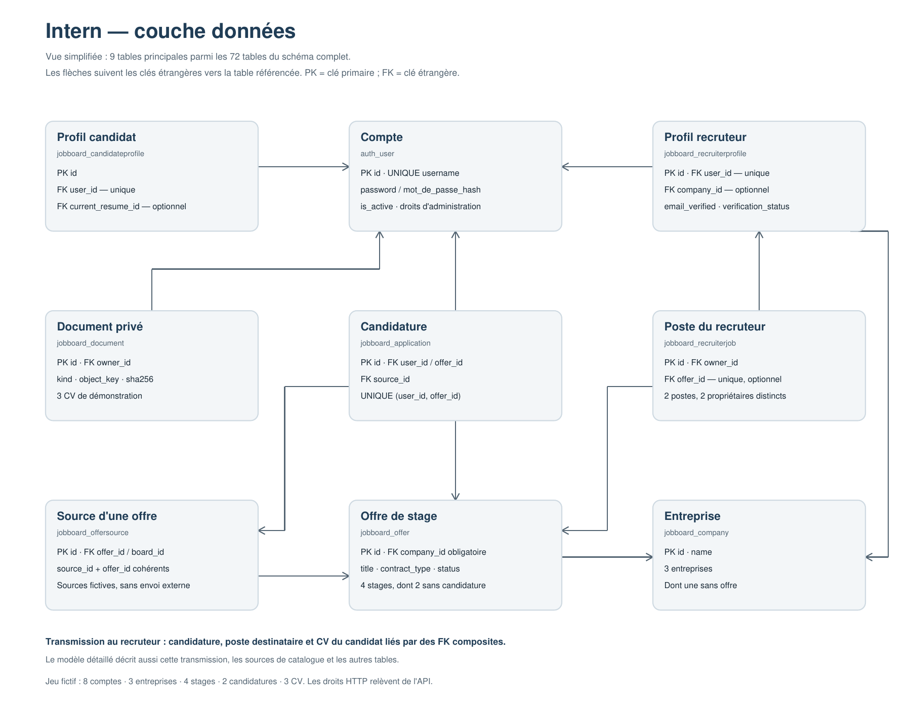
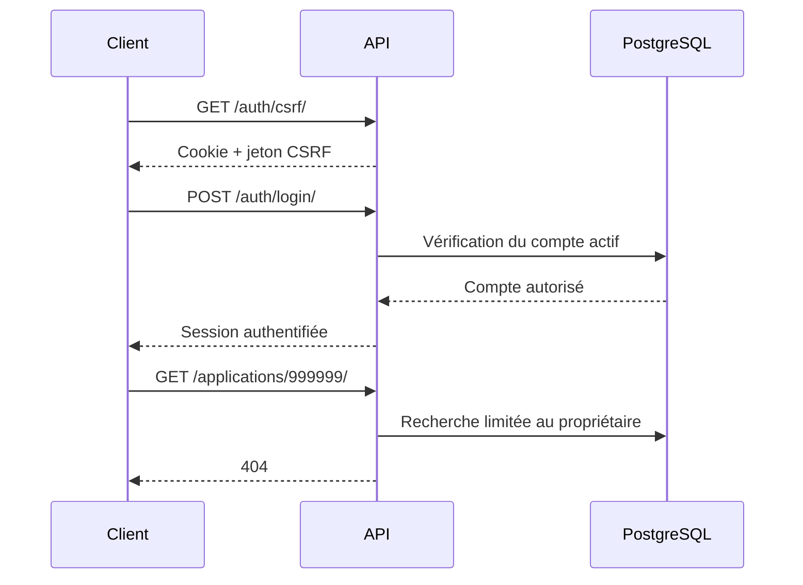
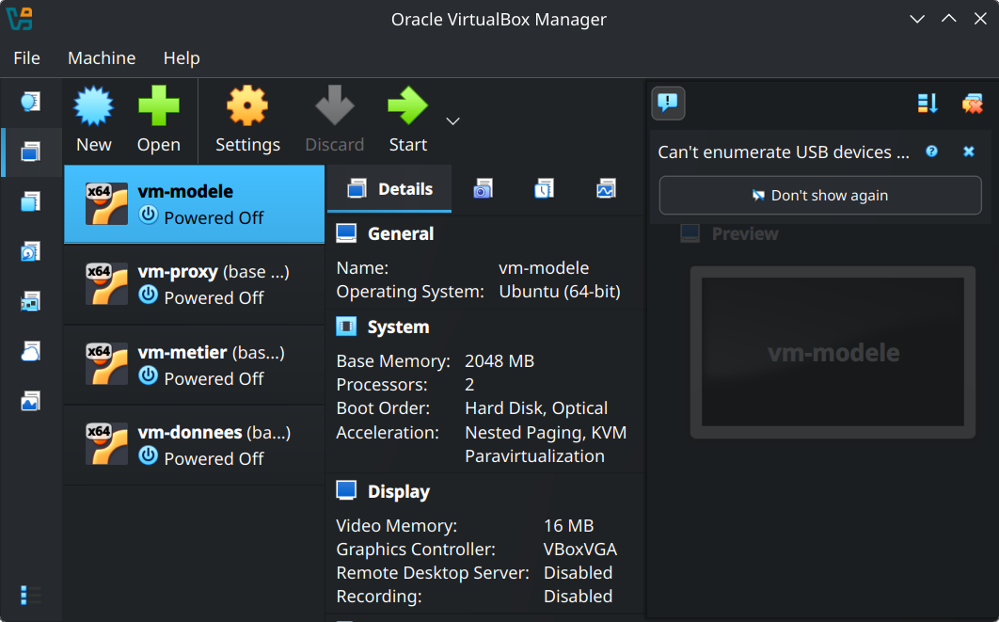
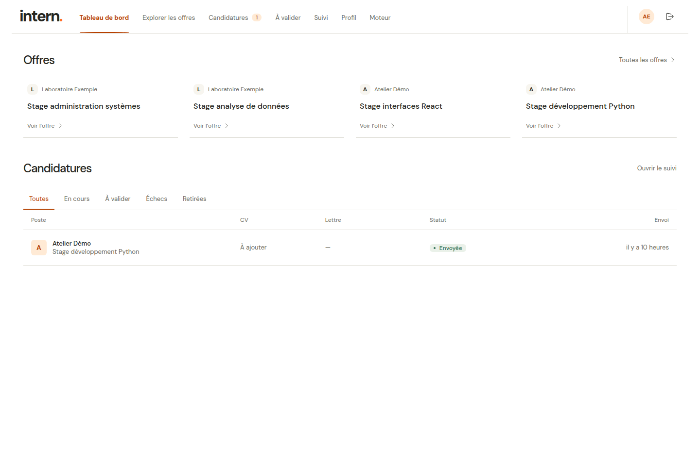
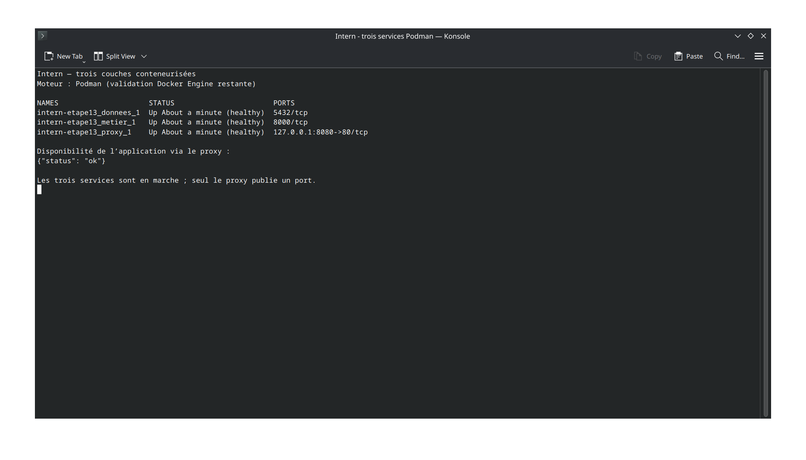
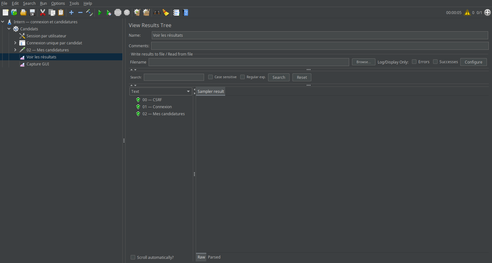
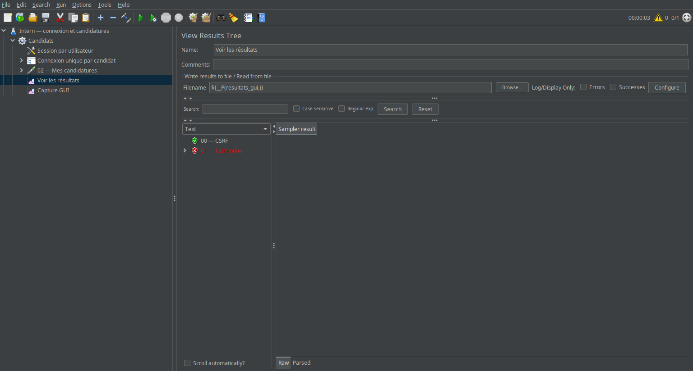

# Intern — suivi des livrables

Ce document recense les livrables d'Intern, leur emplacement et leur état
de vérification. Chaque étape regroupe les documents et les preuves techniques
nécessaires à sa revue.

## Avancement

| Étape | État du dossier | Livrables et emplacement |
| --- | --- | --- |
| 1 — Analyse | Livrables préparés | [Analyse à remettre (PDF)](analyse/cas_d_usage.pdf), [source de l'analyse](analyse/cas_d_usage.md), [procédure de génération](analyse/README.md) |
| 2 — Prototype Figma | Livrables préparés | [Liens Figma](maquette/figma_link.txt), [capture de l'écran zéro](maquette/ecran_zero.jpg), [descriptif](maquette/README.md), [manifest du prototype](maquette/figma_manifest.json) |
| 3 — Couche données | Livrables préparés et vérifiés localement | [Schéma SQL](donnees/schema.sql), [jeu fictif](donnees/data.sql), [requêtes](donnees/requetes.sql), [modèle et règles](donnees/MODELE.md), [installation](donnees/README.md), [rapport de validation](donnees/VALIDATION.md) |
| 4 — Couche métier | Livrables préparés et vérifiés localement | [code de l'API](metier/app/), [démarrage et architecture](metier/README.md), [exemples HTTP](metier/api.http), [dépendances](metier/requirements.txt), [configuration](metier/.env.example), [rapport de validation](metier/VALIDATION.md) |
| 5 — Couche présentation | Livrables préparés et vérifiés localement | [code frontend](frontend/src/), [démarrage](frontend/README.md), [captures](frontend/captures/README.md), [rapport de validation](frontend/VALIDATION.md) |
| 6 — Intégration et tests | Recette locale réussie ; vérifications externes restantes | [cahier de tests PDF](tests/cahier_de_tests.pdf), [source du tableau](tests/cahier_de_tests.html), [guide d'installation](README.md#installer-et-démarrer-en-local), [procédure de recette](tests/README.md), [script reproductible](tests/recette_navigateur.mjs) |
| 7 — Préparation des VM | Trois machines nommées et dimensionnées, snapshots initiaux et capture vérifiés | [Capture VirtualBox](deploiement/docs/virtualbox-machines.png), [Procédure CLI](deploiement/scripts/PROCEDURE.md), [rapport de vérification](deploiement/docs/etape7.md), [preuves CLI](deploiement/docs/preuves-etape7.txt), [identités et snapshots](deploiement/docs/identites-etape7.json) |
| 8 — Réseau et adressage | Réseau interne configuré et vérifié sur les trois VM ; six pings réussis | [Plan et procédure](deploiement/reseau/README.md), [Netplan proxy](deploiement/reseau/vm-proxy.yaml), [Netplan métier](deploiement/reseau/vm-metier.yaml), [Netplan données](deploiement/reseau/vm-donnees.yaml), [rapport](deploiement/docs/etape8.md), [sorties de vérification](deploiement/docs/preuves-etape8.txt) |
| 9 — Déploiement des couches | Services installés et vérifiés après redémarrage ; huit contrôles navigateur réussis | [Configurations et procédure](deploiement/DEPLOIEMENT.md), [rapport](deploiement/docs/etape9.md), [preuves VM](deploiement/docs/preuves-etape9.txt), [recette navigateur](deploiement/docs/recette-etape9.txt), [capture réelle](deploiement/docs/etape9-tableau-de-bord.png) |
| 10 — Vérification et mesures | Neuf liaisons conformes, trois séries mesurées et trois OVA créés et contrôlés | [Procédure](deploiement/VERIFICATION.md), [rapport](deploiement/docs/etape10.md), [mesures](deploiement/docs/mesures.md), [preuves réseau](deploiement/docs/preuves-etape10.txt), [manifeste des OVA](deploiement/docs/exports-etape10.json) |
| 11 — Données conteneurisées | Peuplement et persistance vérifiés sur Docker Engine à l'étape 14 | [Service et volume](docker/compose.yaml), [configuration](docker/.env.example), [procédure](docker/PROCEDURE.md), [vérificateur](docker/verifier-donnees.sh), [rapport initial](docker/docs/etape11.md), [preuve Docker](docker/docs/verification-etape14.json) |
| 12 — Image métier | Image construite ; contenu et connexion SQL vérifiés sur Docker Engine à l'étape 14 | [Dockerfile](docker/metier.Dockerfile), [exclusions](docker/.dockerignore), [composition](docker/compose.yaml), [procédure](docker/PROCEDURE.md), [vérificateur](docker/verifier-metier.sh), [rapport](docker/docs/etape12.md), [preuve initiale](docker/docs/verification-image-etape12.txt), [tailles Docker](docker/docs/mesures-etape14.json) |
| 13 — Proxy et composition | Trois services sains, persistance, 34 contrôles SQL et huit contrôles navigateur réussis sur Docker Engine à l'étape 14 | [Fichier de composition](docker/compose.yaml), [configuration du proxy](docker/proxy.conf), [Dockerfile du proxy](docker/proxy.Dockerfile), [commandes](docker/demarrer.sh), [capture initiale des services](docker/docs/etape13-services.png), [connexion Docker](docker/docs/etape14-connexion.png), [tableau de bord Docker](docker/docs/etape14-tableau-de-bord.png), [rapport initial](docker/docs/etape13.md), [preuves Docker](docker/docs/verification-etape14.json) |
| 14 — Vérification et comparaison | Neuf liaisons conformes, trois séries Docker Engine et PDF de deux pages vérifiés ; temps initial non chronométré | [Matrice et tableau comparatif](docs/comparaison.md), [compte rendu PDF](docs/compte_rendu_comparaison.pdf), [matrice brute](docker/docs/joignabilite-etape14.json), [mesures brutes](docker/docs/mesures-etape14.json), [rapport technique](docker/docs/etape14.md), [contrôles des erreurs](docker/docs/verification-etape14.json) |
| 15 — Plan JMeter | Scénario vérifié en CLI et GUI sur Docker isolé ; données communes VM/Docker à préparer avant les campagnes | [Plan](mesure/plan.jmx), [vingt comptes fictifs](mesure/comptes.csv), [procédure](mesure/PROCEDURE.md), [rapport et preuves](mesure/ETAPE15.md), [capture de réussite](mesure/resultats/etape15/reussite.png), [capture d'échec](mesure/resultats/etape15/echec.png) |
| 16 — Étalonnage | Plafond statique mesuré ; deux contrôles identiques sans erreur, écarts de débit et p95 sous 10 % | [Court rapport d'étalonnage](mesure/ETAPE16.md), [protocole fixé](mesure/protocole.json), [mesures et empreintes](mesure/resultats/etape16/etalonnage.json), [contrôle 1](mesure/resultats/etape16/controle-1/brut.csv), [contrôle 2](mesure/resultats/etape16/controle-2/brut.csv), [reproduction](mesure/PROCEDURE.md#étalonnage-en-ligne-de-commande) |
| 17 — Campagnes | Seize paliers vérifiés, zéro erreur ; interruption et reprise documentées | [Rapport et résultats bruts](mesure/ETAPE17.md), [relevé serveur](mesure/resultats/etape17/releve-serveurs.csv), [vérification](mesure/resultats/etape17/verification.json) |
| 18 — Analyse | Courbes et rapport de quatre pages vérifiés ; saturation non observée jusqu'à vingt utilisateurs | [Rapport PDF](mesure/docs/rapport-charge.pdf), [tableau et analyse](mesure/docs/rapport-charge.md), [livrables et reproduction](mesure/ETAPE18.md) |

« Livrables préparés » indique que les fichiers existent. La revue interactive
du prototype et son accès lecture restent à confirmer.

## Étapes déjà préparées

### Étape 1 — Analyse

Livrable : [ouvrir l'analyse fonctionnelle (PDF)](analyse/cas_d_usage.pdf).
Emplacement : `analyse/cas_d_usage.pdf`.

Le document définit les acteurs candidat, recruteur et administrateur, les
règles R1–R6, les cas d'usage UC01–UC11, les erreurs et les données de recette
prévues. Le Markdown est la source ; le PDF est le document à remettre.

### Étape 2 — Prototype

Livrables : [ouvrir le prototype interactif](https://www.figma.com/proto/2zB64zoXsnJQ24R1yysJ72/Intern?node-id=142-38134&scaling=contain&content-scaling=responsive&starting-point-node-id=142%3A38134),
[ouvrir le fichier Figma](https://www.figma.com/design/2zB64zoXsnJQ24R1yysJ72/Intern?node-id=142-38134)
et [voir la capture de l'écran zéro](maquette/ecran_zero.jpg).
Emplacements locaux : `maquette/figma_link.txt` et `maquette/ecran_zero.jpg`.

Le prototype décrit les parcours candidat, recruteur et administrateur.
Le lien de consultation et la capture de l'écran zéro sont les livrables à
présenter ; le manifest conserve les identifiants et le relevé des parcours.
Les informations du manifest ne remplacent pas une revue interactive du Figma.

## Étape 3 — Travail réalisé

### Lancer la base de démonstration

Depuis la racine d'Intern, installer d'abord les dépendances Python :

```sh
uv sync --project metier --frozen
```

PostgreSQL doit ensuite être démarré et accessible sur le port `5433`. Avec
Docker Compose, lancer le service de base de données :

```sh
docker compose up -d db
```

Si PostgreSQL est déjà installé localement, cette commande n'est pas
nécessaire : il suffit de démarrer le serveur et de vérifier ses paramètres de
connexion. Configurer ensuite la connexion puis lancer :

```sh
export PGHOST=127.0.0.1
export PGPORT=5433
export PGUSER=intern_user
export PGDATABASE=intern_dev3
# Fournir le mot de passe via .pgpass ou PGPASSWORD si nécessaire.
bash donnees/demarrer.sh
```

Le script crée une base neuve, importe le schéma et les données, affiche les
consultations et exécute les 34 vérifications SQL. Si cette base existe déjà,
la création est refusée : choisir un autre nom pour une nouvelle démonstration.
Les prérequis et la connexion interactive sont détaillés dans
[la procédure de lancement](donnees/README.md#lancement-guidé).

### Visuel de la couche données



[Ouvrir le visuel en grand](donnees/schema_visuel.png) ·
[Télécharger le schéma en PDF](donnees/schema_visuel.pdf) ·
[Voir les résultats des requêtes](donnees/resultats_requetes.txt)

Cette vue présente les relations principales. Le jeu fictif contient huit
comptes, trois entreprises, quatre stages et deux candidatures. Les détails des
contraintes et des tables complémentaires figurent dans [le modèle](donnees/MODELE.md).

### Livrables et vérifications

1. Déduction du schéma des relations et des règles définies dans l'analyse.
2. Livraison de `donnees/schema.sql` avec clés primaires, étrangères, contraintes
   d'unicité, champs obligatoires et contrôles de cohérence.
3. Livraison de `donnees/data.sql` avec le jeu fictif prévu dans l'analyse : trois
   candidats actifs, un compte en attente, un administrateur, trois recruteurs
   dont deux dans la même entreprise, trois entreprises, quatre stages et deux
   dossiers de candidats différents, avec les cas vides et un CV fictif.
4. Livraison de `donnees/requetes.sql` pour consulter les données et vérifier les
   invariants en SQL direct.
5. Création, peuplement, consultations et tentatives invalides exécutés sur
   PostgreSQL isolé : **34 vérifications SQL et 43 tests Django ciblés réussis**.
   Les commandes, résultats et limites sont consignés dans le rapport.

Le schéma est issu des migrations actuelles ; le jeu fictif est reproductible
avec `seed_dev`. Les choix de conception (PK technique avec
unicité composée, scrypt et colonne de hash générée) sont expliqués dans
[le modèle](donnees/MODELE.md).

## Étape 4 — Couche métier

### Lancer l'API

Depuis la racine d'Intern :

Prérequis : PostgreSQL doit être démarré et accessible avec les paramètres
indiqués dans `metier/.env.example` (notamment la base `intern`, l'utilisateur
`intern_user` et le port `5433`). Sans PostgreSQL actif, la migration, les tests
et le démarrage de l'API échouent car Django ne peut pas se connecter à la base.

```sh
cd metier
cp .env.example .env
uv sync --frozen
uv run --env-file .env app/manage.py migrate
```

Pour vérifier la couche métier avant de démarrer le serveur, exécuter aussi :

```sh
uv run --env-file .env app/manage.py check
uv run --env-file .env app/manage.py makemigrations --check --dry-run
uv run --env-file .env app/manage.py test \
   jobboard.tests.test_auth_api \
   jobboard.tests.test_recruiters \
   jobboard.tests.test_workflow \
   --noinput
uv run ruff check app/jobboard app/config --select E4,E7,E9,F,I
```

Une fois ces contrôles terminés, démarrer l'API avec :

```sh
uv run --env-file .env app/manage.py runserver 127.0.0.1:8000
```

La procédure complète et les commandes de contrôle figurent dans le
[guide de la couche métier](metier/README.md). Le scénario
[api.http](metier/api.http) permet de visualiser les réponses `201`, `403`,
`200`, `404` et `401` dans un client HTTP compatible.

### Visuel des échanges



Le code de l'API est regroupé sous `metier/app`. L'inscription crée un compte
en attente de validation, l'authentification repose sur une session serveur et
les recherches de ressources privées sont limitées au propriétaire connecté.
Les contrôles locaux ont réussi : **41 tests Django/PostgreSQL**, vérification
des migrations, contrôle Django et analyse statique. Le détail et les limites
sont consignés dans le [rapport de validation](metier/VALIDATION.md).

## Étape 5 — Couche présentation

### Lancer l'interface

Après le démarrage de PostgreSQL et de l'API décrit à l'étape 4, ouvrir un
second terminal depuis la racine d'Intern :

```sh
cd frontend
npm ci
npm run dev
```

Ouvrir `http://127.0.0.1:5173/login`. Le proxy Vite transmet les appels REST à
l'API locale ; les paramètres de connexion, de CSRF et du préfixe API figurent
dans [le guide frontend](frontend/README.md).

### Visuel des écrans


[Voir l'inscription en attente](frontend/captures/inscription-attente.png) ·
[Voir le profil candidat](frontend/captures/profil-candidat.png) ·
[Voir l'espace recruteur](frontend/captures/espace-recruteur.png)

Ces captures proviennent de tests navigateur avec données fictives et réponses
API contrôlées. Les parcours, les contrôles exécutés et ce qu'il reste à
vérifier sur un déploiement réel sont détaillés dans le
[rapport de validation](frontend/VALIDATION.md).

## Étape 6 — Intégration et tests

Le [cahier de recette PDF](tests/cahier_de_tests.pdf) reprend le tableau des
actions, attentes, résultats et statuts. Sa
[source HTML](tests/cahier_de_tests.html) est régénérable avec
`node tests/generer_cahier.mjs`.

Sur une base PostgreSQL éphémère, neuve et peuplée de données fictives,
**15 parcours navigateur/API** ont réussi avec Vite, Django et Django Admin
réels. La suite métier compte **560 tests réussis**. Le client compte
**104 tests navigateur réussis** avec réponses API contrôlées ; trois scénarios
optionnels de logos externes sont ignorés. Le build, le lint, le contrôle
Django, la vérification des migrations et Ruff passent. Les commandes sont
dans le [guide de recette](tests/README.md), et l'installation pas à pas est
dans le [README principal](README.md#installer-et-démarrer-en-local).

Le PDF marque séparément l'installation sur une machine virtuelle vierge et la
comparaison interactive avec le prototype comme **à vérifier**. Aucun résultat
de déploiement ou de service externe n'est déduit de la recette locale.

## Étape 7 — Préparation des trois machines

[Procédure CLI](deploiement/scripts/PROCEDURE.md)

Les trois machines sont nommées, dimensionnées et disposent chacune du snapshot
initial **« base propre »**. Le modèle commun est conservé en plus des trois clones.

| Machine | vCPU | RAM | Snapshot initial |
| --- | ---: | ---: | --- |
| vm-proxy | 1 | 1 Gio | base propre |
| vm-metier | 2 | 2 Gio | base propre |
| vm-donnees | 2 | 2 Gio | base propre |



Cette capture réelle du gestionnaire VirtualBox montre les trois clones et le
modèle, tous éteints. Les noms des snapshots sont abrégés dans cette fenêtre ;
leurs noms complets et les ressources vérifiées figurent dans les
[preuves CLI](deploiement/docs/preuves-etape7.txt) et le
[rapport de vérification](deploiement/docs/etape7.md).

## Étape 8 — Réseau et adressage

Le réseau interne **`intnet-app`** relie les trois machines sur `10.10.10.0/24`.
Le proxy conserve seul un adaptateur NAT, avec la redirection
**`127.0.0.1:8080 → 80`**.

| Machine | Interface interne | Adresse | NAT |
| --- | --- | --- | --- |
| vm-proxy | enp0s3 | 10.10.10.10/24 | enp0s8 |
| vm-metier | enp0s3 | 10.10.10.20/24 | Aucun |
| vm-donnees | enp0s3 | 10.10.10.30/24 | Aucun |

Après redémarrage sur cette topologie, **les six pings ont réussi avec 0 % de
perte** : chaque machine joint les deux autres. Les VM métier et données n'ont
aucune route IPv4 par défaut. Les fichiers Netplan installés correspondent aux
fichiers livrés. Les snapshots **« avant reseau »** sont conservés, les accès SSH
temporaires sont retirés et les machines sont éteintes après vérification.

Livrables : [plan et procédure](deploiement/reseau/README.md), fichiers Netplan
[proxy](deploiement/reseau/vm-proxy.yaml), [métier](deploiement/reseau/vm-metier.yaml)
et [données](deploiement/reseau/vm-donnees.yaml),
[sorties des commandes](deploiement/docs/preuves-etape8.txt) et
[rapport](deploiement/docs/etape8.md).

L'installation des paquets avec une ouverture NAT ponctuelle puis son retrait
est décrite à l'étape 9. La réponse HTTP et l'isolation des services applicatifs
sont vérifiées aux étapes 9 et 10.

## Étape 9 — Déploiement des trois couches

PostgreSQL, Django/Gunicorn et Nginx sont installés respectivement sur
`vm-donnees`, `vm-metier` et `vm-proxy`. Chaque couche dispose de son snapshot
avant installation. Le code applicatif est inchangé ; les configurations réseau,
base, environnement, service systemd et serveur web sont rassemblées dans
la [procédure de déploiement](deploiement/DEPLOIEMENT.md).

Après redémarrage complet, les services démarrent automatiquement et
l'application est accessible sur **http://127.0.0.1:8080/login**.
Les **34 vérifications SQL** et les **huit contrôles navigateur réels** ont réussi.
Les empreintes des fichiers déployés correspondent aux sources et au build.
Les NAT temporaires du métier et des données ainsi que l'accès SSH temporaire
du proxy sont retirés ; seule la redirection HTTP est conservée.



Livrables : [rapport](deploiement/docs/etape9.md),
[preuves des services et de la topologie](deploiement/docs/preuves-etape9.txt),
[résultats navigateur](deploiement/docs/recette-etape9.txt),
[empreintes des artefacts](deploiement/docs/artefacts-etape9.json),
[snapshots](deploiement/docs/snapshots-etape9.json) et
[capture de connexion](deploiement/docs/etape9-connexion.png).

La matrice complète de joignabilité, les mesures répétées et les exports OVA
figurent à l'étape 10 ci-dessous.

## Étape 10 — Vérification, mesures et exports

Les **neuf liaisons** de la matrice sont conformes. Les trois accès interdits
échouent réellement : hôte vers métier, hôte vers base, proxy vers base.
La connexion SQL depuis le métier réussit. Les ports d'écoute et les routes
sont relevés dans les [preuves réseau](deploiement/docs/preuves-etape10.txt).

Les mesures comportent **trois séries complètes**, avec dix consultations du
catalogue par série. Le [tableau des mesures](deploiement/docs/mesures.md)
présente les médianes, les séries et la configuration exacte ; les
[valeurs brutes](deploiement/docs/mesures-etape10.json) permettent de refaire
les calculs. Le proxy utilise la paravirtualisation `minimal`, après un blocage
du noyau sur une tentative avec `default/KVM`, documenté dans le rapport.

Les trois archives **`vm-proxy.ova`, `vm-metier.ova`, `vm-donnees.ova`** et
`SHA256SUMS` sont créées sous **`$VM_WORK/exports-etape10`**, hors du dépôt.
Les manifestes internes et la lecture de chaque archive par VirtualBox ont
été vérifiés. Les VM originales sont éteintes après export. Les OVA représentent
l'état installé ; les snapshots restent conservés sur les machines originales.

Livrables : [rapport complet](deploiement/docs/etape10.md),
[matrice brute](deploiement/docs/joignabilite-etape10.json),
[empreintes et tailles des OVA](deploiement/docs/exports-etape10.json),
[sorties des exports](deploiement/docs/preuves-exports-etape10.txt) et
[procédure de vérification et de réimportation](deploiement/VERIFICATION.md).
La [procédure générale](deploiement/PROCEDURE.md) relie les étapes 7 à 10.

## Étape 11 — Couche données conteneurisée

Le [service de données](docker/compose.yaml) utilise PostgreSQL 16.15, le volume
nommé `pgdata` et les deux scripts SQL existants, montés en lecture seule.
Il appartient uniquement au réseau `interne`, sans port publié, et dispose
d'une sonde de santé TCP. La [procédure](docker/PROCEDURE.md) distingue
l'arrêt conservant les données de la suppression du volume et décrit les
vérifications du peuplement et de la persistance.

Les contrôles statiques ont réussi. Le moteur disponible lance Podman et
échoue avant l'exécution ; le démarrage avec Docker Engine et les preuves
réelles restent à produire. Le [rapport](docker/docs/etape11.md) précise
ces limites. L'étape n'est pas déclarée validée.

Ces limites initiales sont levées pour l'exécution à l'étape 14 : le peuplement,
les 34 contrôles SQL et la conservation du volume après recréation sont
vérifiés sur Docker Engine rootless, dans la [preuve finale](docker/docs/verification-etape14.json).

## Étape 12 — Image métier

Le [Dockerfile](docker/metier.Dockerfile) installe les dépendances verrouillées
avant le code dans un constructeur séparé. L'image finale utilise Python slim
et un utilisateur sans privilèges. Le [service métier](docker/compose.yaml)
joint la base via `donnees:5432`, appartient aux deux réseaux et ne publie
aucun port. Son démarrage attend la santé de la base et vérifie les migrations.

La [procédure](docker/PROCEDURE.md) fournit les commandes de construction,
de vérification SQL depuis le métier et de mesure de taille. Les contrôles
statiques sont documentés dans le [rapport](docker/docs/etape12.md).
La recette actuelle est construite et inspectée avec Podman :
**388 668 114 octets**, contre **1 042 844 117 octets** pour l'image locale
antérieure. Git, uv et le cache uv sont absents de l'image finale. Gunicorn
démarre sous le compte `intern` et `/health/live/` répond HTTP 200.
La [preuve](docker/docs/verification-image-etape12.txt) conserve les identifiants
et les empreintes de cette construction. Le script de démarrage intégré à
l'image lors de la composition donne une taille actuelle de **388 668 320 octets**.
La connexion SQL réussit à l'étape 13 avec Podman, puis à l'étape 14 sur
Docker Engine. Ce dernier annonce **372 903 397 octets** pour l'image métier
de même identifiant ; les valeurs Podman précédentes sont conservées avec
leur méthode. Les [mesures finales](docker/docs/mesures-etape14.json) donnent
les tailles annoncées par Docker et l'empreinte des fichiers réellement mesurés.

## Étape 13 — Proxy et composition

### Livrables

| Fichier | Rôle |
| --- | --- |
| [compose.yaml](docker/compose.yaml) | Composition des trois services, deux réseaux, volume et publication du port |
| [proxy.conf](docker/proxy.conf) | Configuration Nginx : client, statiques et transmission au métier |
| [proxy.Dockerfile](docker/proxy.Dockerfile) | Construction de l'image du proxy |
| [demarrer.sh](docker/demarrer.sh) | Construction, démarrage, arrêt et redémarrage |
| [PROCEDURE.md](docker/PROCEDURE.md) | Instructions reproductibles |
| [Capture des trois services](docker/docs/etape13-services.png) | Trois conteneurs sains et réponse du proxy |
| [Capture de connexion](docker/docs/etape13-connexion.png) | Écran servi par le proxy |
| [Capture du tableau de bord](docker/docs/etape13-tableau-de-bord.png) | Application réelle après authentification |
| [Rapport](docker/docs/etape13.md) | Vérifications et limites |
| [Preuves de composition](docker/docs/preuves-etape13.json) | États, réseaux, ports, images et redémarrage |
| [Recette navigateur](docker/docs/recette-etape13.txt) | Huit contrôles réels |
| [Résultats SQL](docker/docs/sql-etape13.txt) | 34 contrôles depuis le métier |

### Captures



[Voir l'écran de connexion](docker/docs/etape13-connexion.png) ·
[Voir le tableau de bord](docker/docs/etape13-tableau-de-bord.png).

### Synthèse des vérifications

L'image du proxy contient le client React et les statiques Django.
Nginx transmet les appels au service `metier`, sans adresse IP fixe.
La composition comporte trois services, deux réseaux et un seul volume nommé.
Seul le proxy publie le port `127.0.0.1:8080` ; les dépendances attendent
la santé des services précédents.

Sur un projet Podman isolé, les trois conteneurs sont sains. L'arrêt puis la
recréation par Compose conservent les données. Les **34 contrôles SQL** et
les **huit contrôles navigateur réels** réussissent. La
[capture des services](docker/docs/etape13-services.png), le
[rapport](docker/docs/etape13.md) et les
[preuves](docker/docs/preuves-etape13.json) sont livrés.
La [recette finale](docker/docs/recette-etape14.txt) confirme les huit contrôles
sur Docker Engine natif. La [preuve finale](docker/docs/verification-etape14.json)
confirme les trois services sains et la persistance après leur recréation.

## Étape 14 — Vérification et comparaison

### Livrables de synthèse

| Livrable | Lien |
| --- | --- |
| Matrice remplie, tableau chiffré et réponses aux trois questions | [comparaison.md](docs/comparaison.md) |
| Compte rendu vérifié de deux pages | [Ouvrir le PDF](docs/compte_rendu_comparaison.pdf) |
| Neuf tentatives de connexion réellement exécutées | [Matrice brute](docker/docs/joignabilite-etape14.json) |
| Trois séries, trente latences et mémoire moteur compris | [Mesures Docker](docker/docs/mesures-etape14.json) |
| Référence des trois séries VM | [Mesures VM](deploiement/docs/mesures-etape10.json) |
| Vérification des erreurs fréquentes et organisation finale | [Rapport technique](docker/docs/etape14.md) |
| Santé, persistance, Nginx et absence des outils/caches | [Preuves finales](docker/docs/verification-etape14.json) |
| Huit contrôles navigateur sur Docker Engine | [Recette finale](docker/docs/recette-etape14.txt) |
| 34 contrôles SQL depuis le métier | [Résultats SQL](docker/docs/sql-etape14.txt) |
| Reproduction et génération du PDF | [Procédure](docker/PROCEDURE.md) |

### Matrice observée

| Depuis | Proxy :80 | Métier :8000 | Données :5432 |
| --- | --- | --- | --- |
| Hôte | Oui, via 8080 | Refus attendu observé | Refus attendu observé |
| Proxy | Sans objet | Oui | Refus attendu observé |
| Métier | Oui | Sans objet | Oui |
| Données | Refus attendu observé | Oui | Sans objet |

Les neuf liaisons sont conformes avec tous les services sains. Les quatre
refus sont réellement testés par IP. Seul le proxy publie un port.

### Comparaison des médianes

| Grandeur | Trois VM | Trois conteneurs Docker Engine |
| --- | ---: | ---: |
| Démarrage jusqu'au catalogue | 20,473 s | 49,844 s |
| Mémoire RSS côté hôte | 1,454 Gio | 0,568 Gio, moteur et auxiliaires compris |
| Disque : taille des fichiers | 10,783 Gio | 0,809 Gio |
| Disque : blocs alloués | 10,755 Gio | 0,864 Gio |
| Latence de consultation | 62,431 ms | 83,385 ms |
| Mise en place initiale | Non chronométrée | Non chronométrée |

Cette campagne Linux utilise **Docker Engine 28.3.3 rootless et Compose 2.39.4**,
VPNKit et fuse-overlayfs. Les différences de versions, ressources, stockage
et snapshots sont expliquées dans le compte rendu. Les conteneurs consomment
moins de mémoire et de stockage, mais sont plus lents dans cette configuration.
Le temps humain initial n'est pas inventé ; la comparaison ne prétend pas
isoler l'effet de la seule technique de virtualisation.

## Étape 15 — Construire le plan de test

### Livrables à remettre

| Livrable | Fichier |
| --- | --- |
| Fichier du plan de test JMeter | [plan.jmx](mesure/plan.jmx) |
| Fichier des vingt comptes fictifs | [comptes.csv](mesure/comptes.csv) |
| Capture d'une exécution à un utilisateur et une itération : parcours réussi | [reussite.png](mesure/resultats/etape15/reussite.png) |
| Capture d'une exécution à un utilisateur et une itération : parcours en échec | [echec.png](mesure/resultats/etape15/echec.png) |

### Parcours réussi

La préparation CSRF, la connexion et la consultation des candidatures
personnelles réussissent ; les trois appels apparaissent en vert dans JMeter.



### Parcours en échec

Avec un mot de passe erroné, la préparation CSRF réussit puis la connexion
reçoit HTTP 401 et déclenche l'assertion. Le fil s'arrête avant la consultation.



Les deux exécutions ont été vérifiées dans l'interface graphique de JMeter
contre un déploiement Docker isolé. La [procédure](mesure/PROCEDURE.md) et le
[rapport technique](mesure/ETAPE15.md) donnent les commandes reproductibles,
les résultats bruts et les prérequis restant à confirmer avant l'étalonnage.

## Étape 16 — Étalonner le protocole

**Livrable à remettre : [court rapport d'étalonnage](mesure/ETAPE16.md).**

Le rapport présente le plafond observé sur une ressource statique du proxy,
les paliers retenus, les durées fixées et les deux exécutions de contrôle
avec leurs écarts. Les mesures sont réalisées avec JMeter en ligne de commande
sur l'hôte. Les deux contrôles applicatifs portent sur le même déploiement
Docker isolé, avec les mêmes comptes et données fictifs ; aucune erreur n'est
détectée et les écarts de débit et de latence p95 restent sous 10 %.

Les [résultats et empreintes](mesure/resultats/etape16/etalonnage.json),
le [protocole commun](mesure/protocole.json) et la
[procédure reproductible](mesure/PROCEDURE.md#étalonnage-en-ligne-de-commande)
complètent le rapport. Les trois VM sont démarrées puis arrêtées proprement ;
le déploiement Docker de référence est remis en marche après les contrôles.
Une base VM dédiée avec le même jeu fictif reste à préparer avant les campagnes
comparatives.

## Étape 17 — Exécuter les campagnes

La [méthode reproductible des étapes 15 à 17](mesure/PROCEDURE.md)
décrit les prérequis, les commandes, le rôle des scripts et les critères de
vérification. Le [diagnostic et la reprise](mesure/ETAPE17.md#diagnostic-et-reprise-après-incident)
explicitent aussi la gestion de l'indisponibilité du moteur Docker.

Livrables attendus : les fichiers de résultats JMeter bruts des séries VM et
Docker, puis les relevés des métriques serveur palier par palier. Deux séries
doivent alterner l'ordre VM/Docker pour vérifier l'effet de l'ordre de passage.

La [procédure](mesure/ETAPE17.md) et le [pilote](mesure/scripts/campagnes17.py)
préparent l'export SQL commun, les campagnes isolées et les relevés CPU,
mémoire, I/O et connexions de base. La lecture des compteurs Linux et
l'alignement des horodatages ont été vérifiés localement.

**Les seize paliers sont terminés et vérifiés techniquement.** Les fichiers
bruts des deux séries sont conservés avec les 48 relevés par service et palier.
Les 22 199 échantillons JMeter ne comportent aucune erreur ; chaque service
possède au moins 22 relevés dans sa fenêtre stable.

Le [relevé des paliers](mesure/resultats/etape17/releve-paliers.csv),
le [relevé serveur](mesure/resultats/etape17/releve-serveurs.csv),
la [vérification](mesure/resultats/etape17/verification.json) et les
[empreintes](mesure/resultats/etape17/SHA256SUMS) rendent la collecte vérifiable.
La [restauration finale](mesure/resultats/etape17/restauration.json) est contrôlée :
trois services de référence sains, HTTP 200 et aucune VM active.
L'interruption du moteur Docker et la reprise sont documentées ; elles limitent
l'interprétation de l'effet de l'ordre de passage. L'analyse comparative est
présentée à l'étape 18 ci-dessous.

## Étape 18 — Analyser et comparer

Les [courbes](mesure/docs/courbes/ensemble.png), le tableau rempli et le
[rapport de quatre pages](mesure/docs/rapport-charge.pdf) établissent les écarts
de débit et de p95, puis répondent aux quatre questions dans leur ordre.
La [source Markdown](mesure/docs/rapport-charge.md) et les
[calculs vérifiables](mesure/resultats/etape18/analyse.json) sont conservés.

Les mesures ne montrent aucune saturation jusqu'à vingt utilisateurs : le
rapport l'indique dans les courbes et le tableau, sans inventer de goulot.
Le métier est le composant le plus chargé en CPU mesuré, sans saturation
démontrée. L'incident Docker et les autres limites de comparaison sont explicités.
Les métriques de démarrage et de repos viennent des étapes 10 et 14, avec
leurs périmètres distincts. La [reproduction](mesure/ETAPE18.md) documente les
commandes, les fichiers d'entrée et les contrôles techniques effectués.

