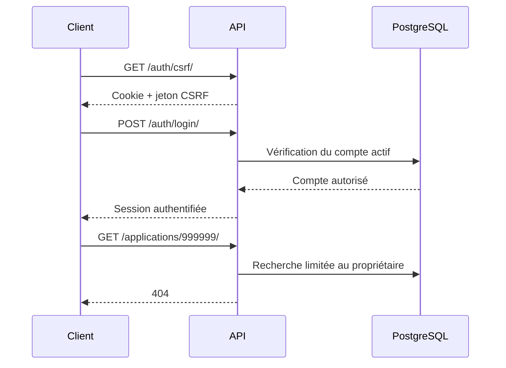

# Intern — suivi des livrables

Ce document recense les livrables d'Intern, leur emplacement et leur état
de vérification. Chaque étape regroupe les documents et les preuves techniques
nécessaires à sa revue.

## Avancement

| Étape | État du dossier | Livrables et emplacement |
| --- | --- | --- |
| 1 — Analyse | Livrables préparés | [Analyse à remettre (PDF)](analyse/cas_d_usage.pdf), [source de l'analyse](analyse/cas_d_usage.md), [procédure de génération](analyse/README.md) |
| 2 — Prototype Figma | Livrables préparés | [Liens Figma](maquette/figma_link.txt), [capture de l'écran zéro](maquette/ecran_zero.jpg), [descriptif](maquette/README.md), [manifest du prototype](maquette/figma_manifest.json) |
| 3 — Couche données | Livrables préparés et vérifiés localement | [Schéma SQL](donnees/schema.sql), [jeu fictif](donnees/data.sql), [requêtes](donnees/requetes.sql), [modèle et règles](donnees/MODELE.md), [installation](donnees/README.md), [rapport de validation](donnees/VALIDATION.md) |
| 4 — Couche métier | Livrables préparés et vérifiés localement | [code de l'API](metier/app/), [démarrage et architecture](metier/README.md), [exemples HTTP](metier/api.http), [dépendances](metier/requirements.txt), [configuration](metier/.env.example), [rapport de validation](metier/VALIDATION.md) |
| 5 — Couche présentation | Livrables préparés et vérifiés localement | [code frontend](frontend/src/), [démarrage](frontend/README.md), [captures](frontend/captures/README.md), [rapport de validation](frontend/VALIDATION.md) |
| 6 — Intégration et tests | Recette locale réussie ; vérifications externes restantes | [cahier de tests PDF](tests/cahier_de_tests.pdf), [source du tableau](tests/cahier_de_tests.html), [guide d'installation](README.md#installer-et-démarrer-en-local), [procédure de recette](tests/README.md), [script reproductible](tests/recette_navigateur.mjs) |
| 7 — Préparation des VM | Trois machines nommées et dimensionnées, snapshots initiaux et capture vérifiés | [Capture VirtualBox](deploiement/docs/virtualbox-machines.png), [Procédure CLI](deploiement/scripts/PROCEDURE.md), [rapport de vérification](deploiement/docs/etape7.md), [preuves CLI](deploiement/docs/preuves-etape7.txt), [identités et snapshots](deploiement/docs/identites-etape7.json) |
| 8 — Réseau et adressage | Réseau interne configuré et vérifié sur les trois VM ; six pings réussis | [Plan et procédure](deploiement/reseau/README.md), [Netplan proxy](deploiement/reseau/vm-proxy.yaml), [Netplan métier](deploiement/reseau/vm-metier.yaml), [Netplan données](deploiement/reseau/vm-donnees.yaml), [rapport](deploiement/docs/etape8.md), [sorties de vérification](deploiement/docs/preuves-etape8.txt) |
| 9 — Déploiement des couches | Services installés et vérifiés après redémarrage ; huit contrôles navigateur réussis | [Configurations et procédure](deploiement/DEPLOIEMENT.md), [rapport](deploiement/docs/etape9.md), [preuves VM](deploiement/docs/preuves-etape9.txt), [recette navigateur](deploiement/docs/recette-etape9.txt), [capture réelle](deploiement/docs/etape9-tableau-de-bord.png) |
| 10 — Vérification et mesures | Neuf liaisons conformes, trois séries mesurées et trois OVA créés et contrôlés | [Procédure](deploiement/VERIFICATION.md), [rapport](deploiement/docs/etape10.md), [mesures](deploiement/docs/mesures.md), [preuves réseau](deploiement/docs/preuves-etape10.txt), [manifeste des OVA](deploiement/docs/exports-etape10.json) |

« Livrables préparés » indique que les fichiers existent. La revue interactive
du prototype et son accès lecture restent à confirmer.

## Étapes déjà préparées

### Étape 1 — Analyse

Livrable : [ouvrir l'analyse fonctionnelle (PDF)](analyse/cas_d_usage.pdf).
Emplacement : `analyse/cas_d_usage.pdf`.

Le document définit les acteurs candidat, recruteur et administrateur, les
règles R1–R6, les cas d'usage UC01–UC11, les erreurs et les données de recette
prévues. Le Markdown est la source ; le PDF est le document à remettre.

### Étape 2 — Prototype

Livrables : [ouvrir le prototype interactif](https://www.figma.com/proto/2zB64zoXsnJQ24R1yysJ72/Intern?node-id=142-38134&scaling=contain&content-scaling=responsive&starting-point-node-id=142%3A38134),
[ouvrir le fichier Figma](https://www.figma.com/design/2zB64zoXsnJQ24R1yysJ72/Intern?node-id=142-38134)
et [voir la capture de l'écran zéro](maquette/ecran_zero.jpg).
Emplacements locaux : `maquette/figma_link.txt` et `maquette/ecran_zero.jpg`.

Le prototype décrit les parcours candidat, recruteur et administrateur.
Le lien de consultation et la capture de l'écran zéro sont les livrables à
présenter ; le manifest conserve les identifiants et le relevé des parcours.
Les informations du manifest ne remplacent pas une revue interactive du Figma.

## Étape 3 — Travail réalisé

### Lancer la base de démonstration

Depuis la racine d'Intern, installer d'abord les dépendances Python :

```sh
uv sync --project metier --frozen
```

PostgreSQL doit ensuite être démarré et accessible sur le port `5433`. Avec
Docker Compose, lancer le service de base de données :

```sh
docker compose up -d db
```

Si PostgreSQL est déjà installé localement, cette commande n'est pas
nécessaire : il suffit de démarrer le serveur et de vérifier ses paramètres de
connexion. Configurer ensuite la connexion puis lancer :

```sh
export PGHOST=127.0.0.1
export PGPORT=5433
export PGUSER=intern_user
export PGDATABASE=intern_dev3
# Fournir le mot de passe via .pgpass ou PGPASSWORD si nécessaire.
bash donnees/demarrer.sh
```

Le script crée une base neuve, importe le schéma et les données, affiche les
consultations et exécute les 34 vérifications SQL. Si cette base existe déjà,
la création est refusée : choisir un autre nom pour une nouvelle démonstration.
Les prérequis et la connexion interactive sont détaillés dans
[la procédure de lancement](donnees/README.md#lancement-guidé).

### Visuel de la couche données


[Ouvrir le visuel en grand](donnees/schema_visuel.png) ·
[Télécharger le schéma en PDF](donnees/schema_visuel.pdf) ·
[Voir les résultats des requêtes](donnees/resultats_requetes.txt)

Cette vue présente les relations principales. Le jeu fictif contient huit
comptes, trois entreprises, quatre stages et deux candidatures. Les détails des
contraintes et des tables complémentaires figurent dans [le modèle](donnees/MODELE.md).

### Livrables et vérifications

1. Déduction du schéma des relations et des règles définies dans l'analyse.
2. Livraison de `donnees/schema.sql` avec clés primaires, étrangères, contraintes
   d'unicité, champs obligatoires et contrôles de cohérence.
3. Livraison de `donnees/data.sql` avec le jeu fictif prévu dans l'analyse : trois
   candidats actifs, un compte en attente, un administrateur, trois recruteurs
   dont deux dans la même entreprise, trois entreprises, quatre stages et deux
   dossiers de candidats différents, avec les cas vides et un CV fictif.
4. Livraison de `donnees/requetes.sql` pour consulter les données et vérifier les
   invariants en SQL direct.
5. Création, peuplement, consultations et tentatives invalides exécutés sur
   PostgreSQL isolé : **34 vérifications SQL et 43 tests Django ciblés réussis**.
   Les commandes, résultats et limites sont consignés dans le rapport.

Le schéma est issu des migrations actuelles ; le jeu fictif est reproductible
avec `seed_dev`. Les choix de conception (PK technique avec
unicité composée, scrypt et colonne de hash générée) sont expliqués dans
[le modèle](donnees/MODELE.md).

## Étape 4 — Couche métier

### Lancer l'API

Depuis la racine d'Intern :

Prérequis : PostgreSQL doit être démarré et accessible avec les paramètres
indiqués dans `metier/.env.example` (notamment la base `intern`, l'utilisateur
`intern_user` et le port `5433`). Sans PostgreSQL actif, la migration, les tests
et le démarrage de l'API échouent car Django ne peut pas se connecter à la base.

```sh
cd metier
cp .env.example .env
uv sync --frozen
uv run --env-file .env app/manage.py migrate
```

Pour vérifier la couche métier avant de démarrer le serveur, exécuter aussi :

```sh
uv run --env-file .env app/manage.py check
uv run --env-file .env app/manage.py makemigrations --check --dry-run
uv run --env-file .env app/manage.py test \
   jobboard.tests.test_auth_api \
   jobboard.tests.test_recruiters \
   jobboard.tests.test_workflow \
   --noinput
uv run ruff check app/jobboard app/config --select E4,E7,E9,F,I
```

Une fois ces contrôles terminés, démarrer l'API avec :

```sh
uv run --env-file .env app/manage.py runserver 127.0.0.1:8000
```

La procédure complète et les commandes de contrôle figurent dans le
[guide de la couche métier](metier/README.md). Le scénario
[api.http](metier/api.http) permet de visualiser les réponses `201`, `403`,
`200`, `404` et `401` dans un client HTTP compatible.

### Visuel des échanges



Le code de l'API est regroupé sous `metier/app`. L'inscription crée un compte
en attente de validation, l'authentification repose sur une session serveur et
les recherches de ressources privées sont limitées au propriétaire connecté.
Les contrôles locaux ont réussi : **41 tests Django/PostgreSQL**, vérification
des migrations, contrôle Django et analyse statique. Le détail et les limites
sont consignés dans le [rapport de validation](metier/VALIDATION.md).

## Étape 5 — Couche présentation

### Lancer l'interface

Après le démarrage de PostgreSQL et de l'API décrit à l'étape 4, ouvrir un
second terminal depuis la racine d'Intern :

```sh
cd frontend
npm ci
npm run dev
```

Ouvrir `http://127.0.0.1:5173/login`. Le proxy Vite transmet les appels REST à
l'API locale ; les paramètres de connexion, de CSRF et du préfixe API figurent
dans [le guide frontend](frontend/README.md).

### Visuel des écrans


[Voir l'inscription en attente](frontend/captures/inscription-attente.png) ·
[Voir le profil candidat](frontend/captures/profil-candidat.png) ·
[Voir l'espace recruteur](frontend/captures/espace-recruteur.png)

Ces captures proviennent de tests navigateur avec données fictives et réponses
API contrôlées. Les parcours, les contrôles exécutés et ce qu'il reste à
vérifier sur un déploiement réel sont détaillés dans le
[rapport de validation](frontend/VALIDATION.md).

## Étape 6 — Intégration et tests

Le [cahier de recette PDF](tests/cahier_de_tests.pdf) reprend le tableau des
actions, attentes, résultats et statuts. Sa
[source HTML](tests/cahier_de_tests.html) est régénérable avec
`node tests/generer_cahier.mjs`.

Sur une base PostgreSQL éphémère, neuve et peuplée de données fictives,
**15 parcours navigateur/API** ont réussi avec Vite, Django et Django Admin
réels. La suite métier compte **560 tests réussis**. Le client compte
**104 tests navigateur réussis** avec réponses API contrôlées ; trois scénarios
optionnels de logos externes sont ignorés. Le build, le lint, le contrôle
Django, la vérification des migrations et Ruff passent. Les commandes sont
dans le [guide de recette](tests/README.md), et l'installation pas à pas est
dans le [README principal](README.md#installer-et-démarrer-en-local).

Le PDF marque séparément l'installation sur une machine virtuelle vierge et la
comparaison interactive avec le prototype comme **à vérifier**. Aucun résultat
de déploiement ou de service externe n'est déduit de la recette locale.

## Étape 7 — Préparation des trois machines

[Procédure CLI](deploiement/scripts/PROCEDURE.md)
j
Les trois machines sont nommées, dimensionnées et disposent chacune du snapshot
initial **« base propre »**. Le modèle commun est conservé en plus des trois clones.

| Machine | vCPU | RAM | Snapshot initial |
| --- | ---: | ---: | --- |
| vm-proxy | 1 | 1 Gio | base propre |
| vm-metier | 2 | 2 Gio | base propre |
| vm-donnees | 2 | 2 Gio | base propre |


Cette capture réelle du gestionnaire VirtualBox montre les trois clones et le
modèle, tous éteints. Les noms des snapshots sont abrégés dans cette fenêtre ;
leurs noms complets et les ressources vérifiées figurent dans les
[preuves CLI](deploiement/docs/preuves-etape7.txt) et le
[rapport de vérification](deploiement/docs/etape7.md).

## Étape 8 — Réseau et adressage

Le réseau interne **`intnet-app`** relie les trois machines sur `10.10.10.0/24`.
Le proxy conserve seul un adaptateur NAT, avec la redirection
**`127.0.0.1:8080 → 80`**.

| Machine | Interface interne | Adresse | NAT |
| --- | --- | --- | --- |
| vm-proxy | enp0s3 | 10.10.10.10/24 | enp0s8 |
| vm-metier | enp0s3 | 10.10.10.20/24 | Aucun |
| vm-donnees | enp0s3 | 10.10.10.30/24 | Aucun |

Après redémarrage sur cette topologie, **les six pings ont réussi avec 0 % de
perte** : chaque machine joint les deux autres. Les VM métier et données n'ont
aucune route IPv4 par défaut. Les fichiers Netplan installés correspondent aux
fichiers livrés. Les snapshots **« avant reseau »** sont conservés, les accès SSH
temporaires sont retirés et les machines sont éteintes après vérification.

Livrables : [plan et procédure](deploiement/reseau/README.md), fichiers Netplan
[proxy](deploiement/reseau/vm-proxy.yaml), [métier](deploiement/reseau/vm-metier.yaml)
et [données](deploiement/reseau/vm-donnees.yaml),
[sorties des commandes](deploiement/docs/preuves-etape8.txt) et
[rapport](deploiement/docs/etape8.md).

L'installation des paquets avec une ouverture NAT ponctuelle puis son retrait
est décrite à l'étape 9. La réponse HTTP et l'isolation des services applicatifs
sont vérifiées aux étapes 9 et 10.

## Étape 9 — Déploiement des trois couches

PostgreSQL, Django/Gunicorn et Nginx sont installés respectivement sur
`vm-donnees`, `vm-metier` et `vm-proxy`. Chaque couche dispose de son snapshot
avant installation. Le code applicatif est inchangé ; les configurations réseau,
base, environnement, service systemd et serveur web sont rassemblées dans
la [procédure de déploiement](deploiement/DEPLOIEMENT.md).

Après redémarrage complet, les services démarrent automatiquement et
l'application est accessible sur **http://127.0.0.1:8080/login**.
Les **34 vérifications SQL** et les **huit contrôles navigateur réels** ont réussi.
Les empreintes des fichiers déployés correspondent aux sources et au build.
Les NAT temporaires du métier et des données ainsi que l'accès SSH temporaire
du proxy sont retirés ; seule la redirection HTTP est conservée.


Livrables : [rapport](deploiement/docs/etape9.md),
[preuves des services et de la topologie](deploiement/docs/preuves-etape9.txt),
[résultats navigateur](deploiement/docs/recette-etape9.txt),
[empreintes des artefacts](deploiement/docs/artefacts-etape9.json),
[snapshots](deploiement/docs/snapshots-etape9.json) et
[capture de connexion](deploiement/docs/etape9-connexion.png).

La matrice complète de joignabilité, les mesures répétées et les exports OVA
figurent à l'étape 10 ci-dessous.

## Étape 10 — Vérification, mesures et exports

Les **neuf liaisons** de la matrice sont conformes. Les trois accès interdits
échouent réellement : hôte vers métier, hôte vers base, proxy vers base.
La connexion SQL depuis le métier réussit. Les ports d'écoute et les routes
sont relevés dans les [preuves réseau](deploiement/docs/preuves-etape10.txt).

Les mesures comportent **trois séries complètes**, avec dix consultations du
catalogue par série. Le [tableau des mesures](deploiement/docs/mesures.md)
présente les médianes, les séries et la configuration exacte ; les
[valeurs brutes](deploiement/docs/mesures-etape10.json) permettent de refaire
les calculs. Le proxy utilise la paravirtualisation `minimal`, après un blocage
du noyau sur une tentative avec `default/KVM`, documenté dans le rapport.

Les trois archives **`vm-proxy.ova`, `vm-metier.ova`, `vm-donnees.ova`** et
`SHA256SUMS` sont créées sous **`$VM_WORK/exports-etape10`**, hors du dépôt.
Les manifestes internes et la lecture de chaque archive par VirtualBox ont
été vérifiés. Les VM originales sont éteintes après export. Les OVA représentent
l'état installé ; les snapshots restent conservés sur les machines originales.

Livrables : [rapport complet](deploiement/docs/etape10.md),
[matrice brute](deploiement/docs/joignabilite-etape10.json),
[empreintes et tailles des OVA](deploiement/docs/exports-etape10.json),
[sorties des exports](deploiement/docs/preuves-exports-etape10.txt) et
[procédure de vérification et de réimportation](deploiement/VERIFICATION.md).
La [procédure générale](deploiement/PROCEDURE.md) relie les étapes 7 à 10.
