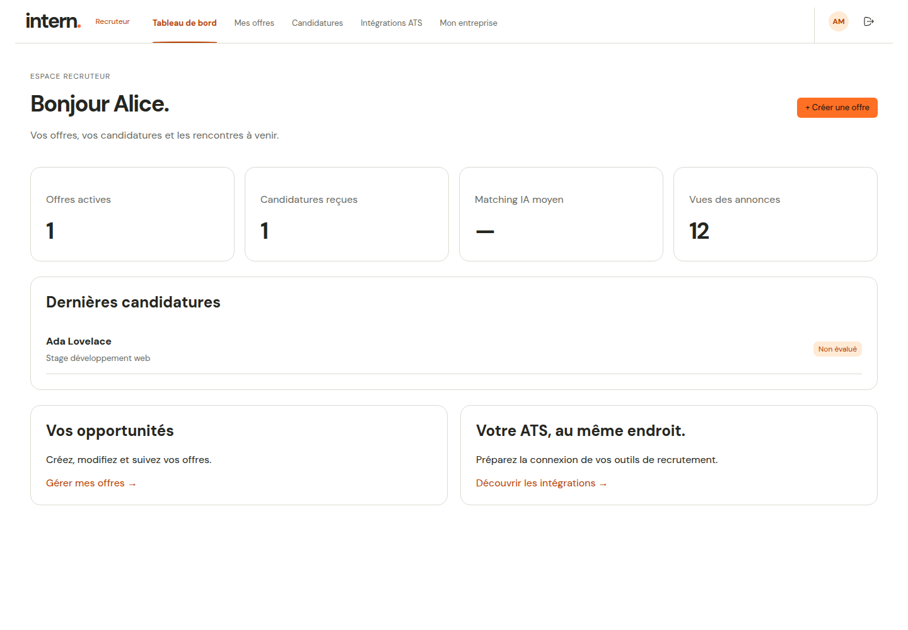

# Intern

**Trouver un stage en Europe et suivre ses candidatures au même endroit.**

Intern est une application web avec un espace candidat pour rechercher des stages,
centraliser son profil et son CV, puis suivre ses démarches. Un espace recruteur
permet de publier des offres et de gérer les candidatures reçues. Le projet sert
également de support à un travail de virtualisation : déploiement en machines
virtuelles, conteneurisation des trois couches et mesures comparatives.



*Capture avec données fictives et réponses API contrôlées. Les autres écrans sont
présentés dans [les captures du frontend](frontend/captures/README.md).*

## Fonctionnalités et état du projet

Le projet est en développement. Les parcours disponibles couvrent :

- **Candidat** : inscription, connexion, profil, CV privé, préférences, recherche
  de stages et suivi des candidatures et entretiens.
- **Recruteur** : vérification de l’entreprise, création et gestion d’offres,
  candidatures reçues et suivi en colonnes.
- **Catalogue** : collecte de sources externes, pages entreprise et publication
  des stages confirmés en Europe, ouverts et récemment vérifiés.
- **Administration** : activation des comptes, vérification des recruteurs et
  gestion des sources via Django Admin.

La préparation et l’envoi automatisé sont partiels : le backend prévoit une
validation individuelle avant envoi, mais le connecteur partenaire Greenhouse
reste désactivé par défaut et exige une clé autorisée. L’interface ne propose pas
encore ce parcours automatisé complet. La rédaction IA, l’extraction automatique
du CV, les scores IA et la synchronisation des intégrations ATS recruteur restent
à implémenter. Voir le [guide technique](docs/exploitation/GUIDE_TECHNIQUE.md) et les
[limites de l’espace recruteur](docs/produit/RECRUITER_WORKSPACE.md).

## Démarrage local

### Prérequis

- Python **3.12+** et [uv](https://docs.astral.sh/uv/).
- Node.js **20.19+ ou 22.12+** et npm.
- Docker Engine avec le plugin Compose, pour PostgreSQL **16**.
- Ports disponibles : **5433** (base), **8000** (API), **5173** (client).

Toutes les commandes suivantes s’exécutent depuis le dossier `Intern/`.
Elles utilisent les paramètres de développement ; les identifiants par défaut
ne conviennent pas à la production.

### 1. Installer et préparer la base

```sh
uv sync --project metier --frozen
npm --prefix frontend ci
docker compose up -d --wait db
uv run --project metier metier/app/manage.py migrate --noinput
uv run --project metier metier/app/manage.py check
```

Sur une installation neuve, la base est vide. Pour découvrir les deux espaces
avec un jeu entièrement fictif :

```sh
uv run --project metier metier/app/manage.py seed_dev
```

Cette commande refuse une base contenant déjà des comptes ou des entreprises.
Elle ne collecte aucune offre externe et n’envoie aucune candidature.

### 2. Démarrer l’API

Dans un premier terminal :

```sh
CSRF_TRUSTED_ORIGINS=http://127.0.0.1:5173 \
  uv run --project metier metier/app/manage.py runserver 127.0.0.1:8000
```

### 3. Démarrer le client

Dans un deuxième terminal :

```sh
npm --prefix frontend run dev
```

Ouvrir [l’application](http://127.0.0.1:5173/login). Utiliser `127.0.0.1`
pour le client et l’API afin de conserver une configuration cohérente des cookies
et du CSRF. Vite transmet les requêtes `/api/v1` à Django.

Avec le jeu fictif, utiliser les comptes suivants et le mot de passe commun
`Intern-Demo-2026!` :

| Accès | Identifiant | Adresse |
| --- | --- | --- |
| Candidat | `alice@example.test` | [Connexion](http://127.0.0.1:5173/login) |
| Recruteur vérifié | `recruteur_a@example.test` | [Connexion](http://127.0.0.1:5173/login) |
| Administration | `admin` | [Django Admin](http://127.0.0.1:8000/admin/) |

Un compte créé via l’inscription reste inactif jusqu’à son activation par un
administrateur. Les autres profils fictifs sont décrits dans le
[guide des données](donnees/README.md).

### Configuration et arrêt

Pour une connexion PostgreSQL personnalisée, copier `metier/.env.example` vers
`metier/.env`, adapter les variables et ajouter `--env-file metier/.env` aux
commandes `uv run`. Django ne charge pas ce fichier automatiquement. Donner
les mêmes valeurs `POSTGRES_DB`, `POSTGRES_USER` et `POSTGRES_PASSWORD` à Compose,
qui lit le fichier `.env` à la racine. Les identifiants doivent correspondre à ceux
du volume PostgreSQL déjà initialisé.

Arrêter les serveurs avec `Ctrl+C`, puis PostgreSQL avec `docker compose stop db`.
Les données restent dans le volume.

En cas de difficulté :

- **Port 8000 occupé** : démarrer Django sur un autre port et lancer Vite avec
  `API_PROXY_TARGET=http://127.0.0.1:<port> npm --prefix frontend run dev`.
- **Erreur CSRF** : vérifier l’origine autorisée au lancement de Django et
  utiliser `127.0.0.1:5173` dans le navigateur.
- **Catalogue vide** : sur une base neuve, charger le jeu fictif ci-dessus ; pour
  les sources externes, consulter le [guide du catalogue](docs/exploitation/INTERNSHIP_ENGINE_RUNBOOK.md).

## Architecture

| Couche | Technologies | Dossier |
| --- | --- | --- |
| Présentation | React, TypeScript, Vite, React Router | [`frontend/`](frontend/README.md) |
| Métier et API | Python, Django, Django REST Framework | [`metier/`](metier/README.md) |
| Données | PostgreSQL 16, migrations Django | [`donnees/`](donnees/README.md) |

Le client appelle l’API, qui applique les règles métier et les droits d’accès avant
de lire ou modifier PostgreSQL. L’authentification utilise des sessions et une
protection CSRF. Les CV restent privés, stockés localement en développement ou
dans un bucket R2 privé selon la configuration.

La collecte du catalogue et l’envoi des candidatures utilisent des processus
distincts. Ils ne sont pas nécessaires pour parcourir le jeu fictif. Leur
configuration est détaillée dans le [guide technique](docs/exploitation/GUIDE_TECHNIQUE.md)
et le [guide d’exploitation du catalogue](docs/exploitation/INTERNSHIP_ENGINE_RUNBOOK.md).

## Vérification

Depuis la racine, avec PostgreSQL démarré :

```sh
uv run --project metier metier/app/manage.py check
uv run --project metier metier/app/manage.py makemigrations --check --dry-run
TEST_DATABASE_NAME=test_intern \
  uv run --project metier metier/app/manage.py test jobboard --noinput
uv run --project metier ruff check metier/app/jobboard metier/app/config --select E4,E7,E9,F,I
npm --prefix frontend run build
npm --prefix frontend run lint
npm --prefix frontend run test:e2e
```

Les tests Django créent une base de test PostgreSQL dédiée ; le compte doit avoir
le droit de la créer. Les tests Playwright demandent Chrome et utilisent des
réponses API contrôlées. Pour vérifier le parcours complet avec Django et
PostgreSQL réels, suivre la [recette d’intégration isolée](tests/README.md).
Les tests ne soumettent aucune candidature à un ATS externe.

## Virtualisation et déploiement

Le dépôt contient plusieurs configurations, chacune avec un usage précis :

| Configuration | Usage | Instructions |
| --- | --- | --- |
| `compose.yaml` | Développement : PostgreSQL, services applicatifs optionnels via le profil `app` | [Guide technique](docs/exploitation/GUIDE_TECHNIQUE.md#docker-applicatif) |
| `docker/compose.yaml` | Travail de conteneurisation : base, métier et proxy Nginx servant le client | [Procédure Docker](docker/PROCEDURE.md) |
| `deploiement/` | Déploiement des trois couches sur machines virtuelles | [Guide VM](deploiement/DEPLOIEMENT.md) |
| `deploy/compose.yaml` | Configuration de déploiement de l’application | [Précautions de production](docs/exploitation/GUIDE_TECHNIQUE.md#production) |

Le [suivi des livrables](LIVRABLES.md) réunit les étapes du travail, les preuves
disponibles et leurs limites. Les mesures se trouvent dans [`mesure/`](mesure/PROCEDURE.md).

## Documentation et contribution

L’[index de la documentation](docs/README.md) regroupe les cahiers des charges,
les livrables et les documents techniques par thème.

| Besoin | Document |
| --- | --- |
| Comprendre les parcours attendus | [Analyse fonctionnelle](analyse/cas_d_usage.md) |
| Consommer l’API | [Routes, requêtes et erreurs](docs/backend/API.md) |
| Comprendre le backend et les traitements | [Guide technique](docs/exploitation/GUIDE_TECHNIQUE.md) |
| Comprendre le modèle de données | [Schéma de la base](docs/database/DATABASE_SCHEMA.md) |
| Exploiter la collecte de stages | [Guide du catalogue](docs/exploitation/INTERNSHIP_ENGINE_RUNBOOK.md) |
| Travailler sur l’espace recruteur | [Parcours et règles d’accès](docs/produit/RECRUITER_WORKSPACE.md) |
| Reproduire les contrôles d’intégration | [Recette et cahier de tests](tests/README.md) |

Pour proposer une modification, consulter la documentation de la couche concernée,
décrire le problème et les vérifications effectuées dans la pull request.
Pour signaler un bug, fournir les étapes de reproduction, le résultat attendu et
le résultat observé, sans joindre de secrets ni de données personnelles.
