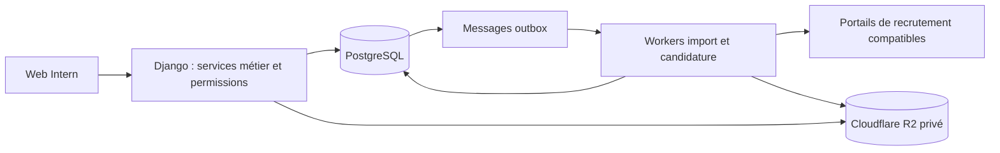
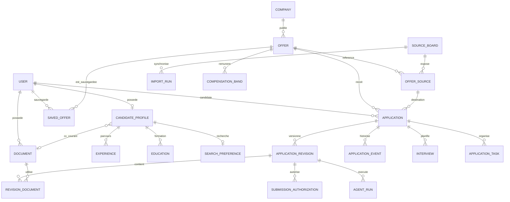
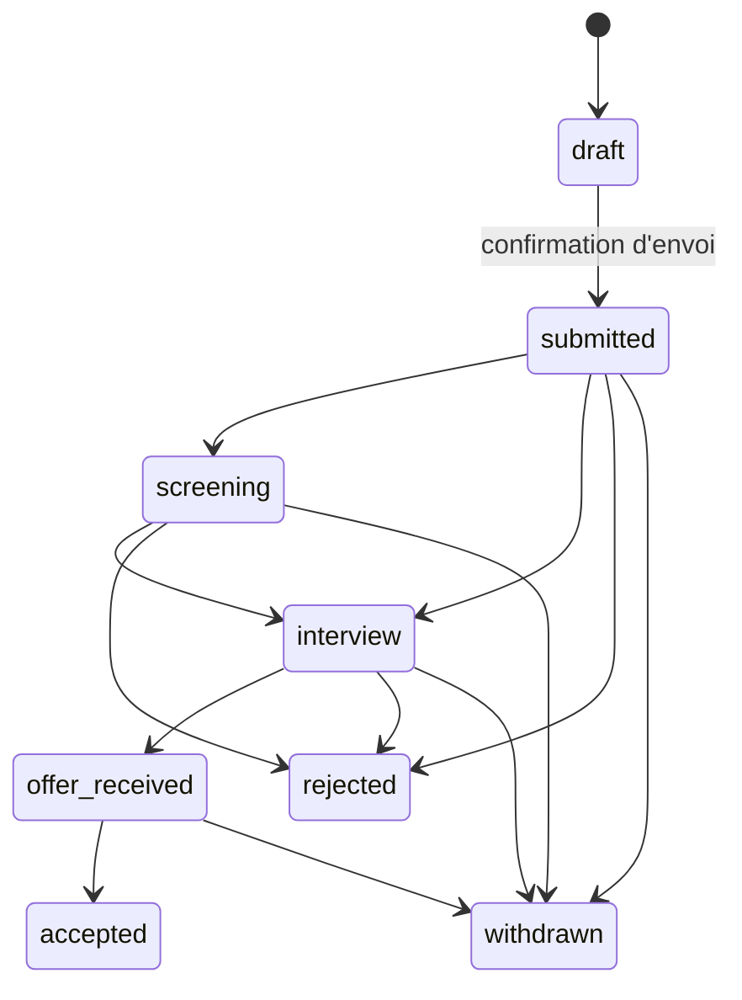

# Intern — Architecture de base de données cible

**Date : 28 septembre 2026. Statut : schéma V1 implémenté dans Django et migré sur PostgreSQL local.**

Voir [DATABASE_IMPLEMENTATION.md](DATABASE_IMPLEMENTATION.md) pour les 34 modèles, les migrations, les adaptations de noms et les 32 tests. Les sections ci-dessous documentent également les services métier à développer autour du schéma.

Cette architecture s’appuie sur la [vision](../produit/VISION.md), l’examen des modèles et des huit migrations existantes et la [recherche concurrentielle](../research/COMPETITOR_DATABASE_RESEARCH.md) portant sur Simplify, Tsenta, Teal et Huntr. Elle remplace la première ébauche de ce document. Elle ne prétend pas reproduire leurs schémas privés.

Le [SQL de référence](schema.sql) définit les colonnes, types, nullabilité, clés, contraintes et index. Il crée un schéma isolé `intern_blueprint` et référence le compte Django existant. **Ce fichier n’est pas une migration et n’a pas été déployé dans les tables de l’application.** Les validations entre plusieurs opérations sont précisées ici ; elles ne sont pas toutes exécutées par le SQL seul.

## 1. Décision d’ensemble

Conserver **Django + PostgreSQL 16**, déjà installés, et proposer **Cloudflare R2 privé** pour les fichiers. Une base relationnelle suffit pour la V1. PostgreSQL porte également la recherche textuelle, la file transactionnelle et les contraintes de cohérence. Les workers exécutent les traitements longs hors des requêtes HTTP et hors des transactions longues.

Le produit garde quatre ensembles métier : **profil**, **catalogue d’offres**, **dossiers de candidature** et **exécutions de l’agent**. Les préférences alimentent la découverte ; les snapshots rendent l’historique indépendant des changements ultérieurs.

### Arbitrages structurants

| Décision | Raison et conséquence |
|---|---|
| Garder le nom `Offer` | Il existe déjà dans le code. `Job` dans l’ancienne proposition désignait la même chose. Une proposition d’embauche sera appelée `EmploymentOffer` si cette extension est développée. |
| Garder `auth.User` pour cette évolution | Les migrations dépendent déjà de `settings.AUTH_USER_MODEL`. Changer de modèle d’authentification maintenant demanderait une migration séparée. Ne pas réécrire les premières migrations. |
| Un CV courant par profil | Respecte la vision Intern, même si des concurrents proposent plusieurs CV sélectionnables. Les variantes envoyées sont des documents historiques privés. |
| Une candidature par utilisateur et offre | Les essais de l’agent deviennent des `AgentRun`. Une recandidature réelle exigera plus tard un numéro de cycle et une nouvelle règle d’unicité. |
| Validation par candidature en V1 | Une autorisation référence une révision et son empreinte. Le mode autonome de sélection reste une extension, conformément à la vision. |
| Statuts métier et techniques distincts | `interview` n’est pas un état de worker ; un timeout n’est pas un refus employeur. |
| Normaliser les valeurs filtrables | Compétences, rôles, lieux, contrats, statuts et rémunération sont structurés. Réserver JSON aux formulaires variables et aux snapshots. |
| Pas de moteur vectoriel au lancement | Matching explicable sur préférences, compétences et rôle ; ajouter une recherche sémantique après mesure de sa valeur. |

L’[ADR-001](../decisions/001-database-architecture.md) consigne les raisons et compromis.

## 2. Ce que les sources changent concrètement

Le [rapport concurrentiel](../research/COMPETITOR_DATABASE_RESEARCH.md) présente 19 sources officielles et distingue faits et inférences. Trois enseignements guident cette proposition : un profil structuré ne se réduit pas au fichier CV ; un dossier privé doit conserver ce qui a réellement été envoyé ; une validation porte sur un contenu précis. La recherche confirme ces besoins fonctionnels, sans révéler les tables internes concurrentes.

Les ATS apportent des **contrats de données publics**, utiles pour construire des imports fiables :

| Source technique | Observation documentée | Choix pour Intern |
|---|---|---|
| [Greenhouse Job Board API](https://docs.greenhouse.io/job-board.html) | Distingue identifiant d’annonce et identifiant du recrutement ; expose questions et options. Les lectures sont publiques, la soumission API demande une clé. | `OfferSource.external_id` identifie l’annonce dans son board. Conserver l’identifiant de recrutement séparément et versionner le formulaire. Une API lisible n’autorise pas automatiquement Intern à soumettre via celle-ci. |
| [Lever Postings API](https://github.com/lever/postings-api) | Les annonces sont rattachées à un site ; instances global/EU ; URL d’annonce et de candidature, catégories et salaire structuré. | Identité de source `(provider, instance, board_key, external_id)` ; URL d’origine distincte de l’URL de candidature. |
| [Ashby Job Postings API](https://developers.ashbyhq.com/docs/public-job-posting-api) | Lieux secondaires, emploi, mode de travail, visibilité, rémunération en composantes/tranches ; données parfois manquantes. | Plusieurs lieux et tranches salariales, valeurs inconnues explicites. Une annonce non listée ne doit pas être publiée par défaut dans notre catalogue. |

Ces champs décrivent les APIs, pas le schéma interne des ATS. Les connecteurs ne sont pas encore réalisés ; leur accès et leur compatibilité devront être vérifiés pour les premiers portails choisis.

## 3. Vue des relations

Les tables d’association et d’exploitation sont détaillées ensuite ; ce diagramme montre les cardinalités principales.

## 4. Conventions et dictionnaire physique

Le SQL constitue la définition exacte des colonnes. Convention générale : `bigint identity` pour les nouvelles clés, `integer` pour les FK vers le `auth_user.id` existant, `timestamptz` pour les instants, `date` pour les dates civiles, `numeric` pour l’argent. Les IDs ne sont jamais une permission d’accès. `NULL` signifie inconnu/non applicable ; une chaîne vide n’est pas une fausse réponse.

Les tables d’association ont une clé technique et une contrainte d’unicité sur la paire : traduction directe en modèles Django `through`. Les enums sont des chaînes contraintes par `CHECK`, à représenter par `TextChoices` **et** `CheckConstraint` ; `choices=` seul ne suffit pas à garantir les écritures SQL. Les champs `updated_at` sont mis à jour par le service Django ; le défaut SQL `now()` ne se réexécute pas à chaque modification.

### A. Identité, profil et préférences

| Table / modèle Django | Champs et rôle | Relations et invariants |
|---|---|---|
| `public.auth_user` / modèle utilisateur actuel | Authentification Django, identifiant, email, mot de passe haché, état actif | Conservé en l’état. Aucun doublon de table de mots de passe. L’email n’est pas rendu unique silencieusement. |
| `candidate_profile` / `CandidateProfile` | Nom complet, noms structurés facultatifs, téléphone, présentation, lieu, disponibilité, liens, CV courant, `profile_version` | Un par utilisateur. La FK composite du CV impose même propriétaire et type `resume`. Le service exige un document `ready`. |
| `experience` / `Experience` | Entreprise en texte, intitulé, dates, précision, description et ordre | Plusieurs par profil. Un ancien employeur ne doit pas obligatoirement exister dans le catalogue `Company`. Fin ≥ début ; poste actuel sans fin. |
| `education` / `Education` | Établissement, diplôme, domaine, dates, précision, description et ordre | Plusieurs par profil. Ne pas inventer un jour précis à partir d’une année ou d’un mois. |
| `project` / `Project` | Titre, description, lien, ordre | Plusieurs par profil. |
| `skill` / `Skill` | Nom et slug canonique | Identité stable indépendante des variations de casse ; alias éventuels plus tard. |
| `candidate_skill` / `CandidateSkill` | Profil et compétence | Paire unique ; pas de niveau inventé par l’IA. |
| `work_authorization` / `WorkAuthorization` | Pays, droit de travail, besoin de sponsoring, date de confirmation | Un par profil/pays. Booléens nullables : absence de réponse ≠ non. Ne pas déduire la nationalité. |
| `search_preference` / `SearchPreference` | Salaire plancher/devise/période, convention brut/net, mobilité, modification | Un par profil ; montant/devise/période sont renseignés ensemble ou tous absents. Convention `salary_gross_net`, brute par défaut, présentée explicitement à l’utilisateur. |
| `preference_role` / `PreferenceRole` | Préférence et rôle | Paire unique ; ensemble vide = aucune restriction de rôle. |
| `preference_location` / `PreferenceLocation` | Préférence et lieu | Paire unique ; ensemble vide = aucune restriction géographique. |
| `preference_contract` / `PreferenceContract` | Préférence et type de contrat | Paire unique. Ensemble vide = aucun contrat accepté, pas « tous ». Initialiser explicitement les choix. Pour reprendre les défauts actuels : stage, alternance et emploi salarié. |
| `preference_work_mode` / `PreferenceWorkMode` | Préférence et mode de travail | Paire unique. Même convention que les contrats ; initialiser les trois modes pour reprendre les défauts actuels. |

Les faits extraits du CV restent des suggestions tant que l’utilisateur ne les confirme pas. En V1, cette étape peut utiliser une révision de préparation et l’interface de modification du profil ; aucun profil « vérifié » ne doit être dérivé du seul succès d’un parseur. `profile_version` augmente lors de chaque modification pertinente, y compris expérience, compétence et CV courant, dans la même transaction.

### B. Catalogue, import et sauvegarde

| Table / modèle Django | Champs et rôle | Relations et invariants |
|---|---|---|
| `company` / `Company` | Nom, site, domaine, description, logo | Le nom et le domaine ne sont pas uniques : marques, filiales et domaines partagés. |
| `role` / `Role` | Nom et slug | Référentiel métier, indépendant de l’intitulé libre de l’offre. |
| `location` / `Location` | Clé canonique, libellé, pays, région, ville | Libellé non unique. Clé stable de fournisseur géographique ou clé interne ; garder les lieux ambigus non résolus en texte. |
| `offer` / `Offer` | Entreprise, rôle facultatif, titre, description texte, contrat, durée de travail, séniorité, télétravail, dates, statut et vecteur de recherche | `unknown` si l’import ne sait pas. `remote` n’implique pas travail depuis tous les pays : conserver `remote_scope`. |
| `offer_location` / `OfferLocation` | Offre et lieu | Plusieurs lieux, paire unique. |
| `offer_skill` / `OfferSkill` | Offre, compétence, importance | Plusieurs compétences, paire unique. |
| `source_board` / `SourceBoard` | Fournisseur, instance, board, entreprise éventuelle, URL, adaptateur, capacité d’envoi | Triplet unique. Un agrégateur peut ne pas être associé à une seule entreprise. Aucun secret d’API dans cette table. |
| `import_run` / `ImportRun` | Board, état, début/fin, couverture complète ou partielle, compteur, code erreur | Sert à distinguer fermeture réelle et import interrompu. |
| `offer_source` / `OfferSource` | Offre, board, ID externe, ID recrutement éventuel, URLs, observation, hash, payload brut expirable | Unicité `(board_id, external_id)` ; un import associé doit appartenir au même board. |
| `compensation_band` / `CompensationBand` | Offre/source, lieu facultatif, libellé, min/max, devise/période, brut/net | Plusieurs tranches ; bornes non négatives. Ne contient que salaire de base monétaire ; bonus et equity restent dans le brut d’import si utiles. |
| `saved_offer` / `SavedOffer` | Utilisateur, offre, date | Un favori par paire. Supprimer le favori ne supprime aucune candidature. |

Le contrat distingue stage, alternance, emploi salarié, prestation et temporaire. Temps plein/partiel est un autre axe. Un pays absent reste inconnu. Les codes sont normalisés à l’import (pays ISO à deux lettres, devise à trois lettres) ; le `CHECK` SQL contrôle la forme, le service contrôle l’appartenance au référentiel.

### C. Documents, préparation, validation et suivi

| Table / modèle Django | Champs et rôle | Relations et invariants |
|---|---|---|
| `document` / `Document` | Propriétaire, type, origine, bucket/clé R2, nom, MIME, taille, SHA-256, état et filiation | Objet privé, clé unique jamais réutilisée. Filiation limitée au même utilisateur ; le service interdit les cycles. |
| `application` / `Application` | Utilisateur, offre, source choisie, état métier, dates, référence externe | Une par utilisateur/offre. La FK composite garantit source et offre cohérentes. |
| `application_revision` / `ApplicationRevision` | Numéro, version de format, snapshots profil/offre/formulaire, réponses, versions générateur/prompt, hash, date de gel | Une révision appartient à un seul dossier/utilisateur ; numéro unique dans le dossier. |
| `revision_document` / `RevisionDocument` | Révision, propriétaire, document, usage | Un CV et une lettre au maximum par révision ; propriétaire et type imposés par FK composites. |
| `submission_authorization` / `SubmissionAuthorization` | Révision, dossier, utilisateur, hash approuvé, mode, dates d’octroi/expiration/révocation | Approbation par le propriétaire. Un seul accord non révoqué par révision. Révoquer l’accord expiré avant d’en créer un nouveau. |
| `agent_run` / `AgentRun` | Dossier/révision/accord, préparation ou envoi, état, phase, idempotence, numéro d’essai, lease worker, preuves, dates | Un seul essai actif ou incertain par dossier. Envoi impossible sans référence d’autorisation ; sa validité effective est contrôlée par le service. |
| `application_event` / `ApplicationEvent` | Dossier, essai éventuel, événement, origine, état résultant, date métier et réception, clé de dédoublonnage, payload | Historique append-only dans le service. L’essai cité doit appartenir au dossier. |
| `interview` / `Interview` | Dossier, titre, début/fin, fuseau d’affichage, lien/lieu, statut, notes | Plusieurs tours par dossier. `timestamptz` + fuseau IANA pour l’affichage. |
| `application_task` / `ApplicationTask` | Dossier, intitulé, échéance, réalisation | Une action prévue n’est pas un événement déjà accompli. |

En V1, pas de table `Submission` supplémentaire : un `AgentRun` d’envoi confirmé, sa révision figée, son reçu et un événement `submission_confirmed` représentent la soumission. Une préparation réussie ne marque jamais la candidature envoyée. Si des envois distincts ou cycles de recandidature arrivent plus tard, introduire `Submission` avant de relâcher les unicités.

### D. Exploitation

| Table / modèle Django | Rôle | Invariant |
|---|---|---|
| `outbox_message` / `OutboxMessage` | Commande durable : démarrer un run, supprimer un objet R2 ; contenu limité aux IDs/clé objet nécessaires | Écrite dans la transaction métier ; `dedupe_key` unique ; lease et retries. Transport au moins une fois, consommateurs idempotents. |
| `deletion_request` / `DeletionRequest` | Progression de suppression, erreur et date de fin | Une demande par compte ; le lien devient nul après effacement du compte. Conserver uniquement un reçu sans identité personnelle. |

Le suivi de publication d’une commande et l’exécution du travail sont distincts. Une commande n’est `processed` qu’après prise en charge durable ; si aucun broker n’est retenu, le worker lit directement l’outbox. Les sessions Django restent gérées par Django.

## 5. JSON : contrats et limite de normalisation

Les snapshots ont `schema_version=1`, sont validés avant écriture et bornés en taille. Le SQL contrôle objet/tableau ; il ne valide pas leurs champs internes. Aucun pickle, mot de passe, cookie ou token dans ces JSON.

| Colonne | Contrat attendu |
|---|---|
| `profile_snapshot` | `{profile_version, captured_at, identity, experiences, education, projects, skills, work_authorizations}`. Copier uniquement les faits nécessaires à cette candidature ; références aux IDs d’origine pour traçabilité. |
| `offer_snapshot` | `{offer_id, title, company_name, description_text, locations, compensation, source:{provider,instance,board_key,external_id,apply_url}, captured_at}`. L’URL de destination approuvée est figée ici. |
| `form_snapshot` | `{form_fingerprint, fetched_at, fields:[{key,label,type,required,options,conditions}], notices:[...]}`. Identifiants d’option et textes conservés ; fingerprint du formulaire et de ses avis pertinents. |
| `answers` | `[{field_key, value, origin, source_refs, confirmed_at}]`. `origin` parmi `profile`, `user`, `generated`. Clés uniques et valides dans le formulaire. `null`, vide et « préfère ne pas répondre » restent distincts. |
| `raw_payload` | Réponse source nettoyée, bornée et expirable. Utile pour diagnostiquer une normalisation ; ne sert pas de vérité filtrable. |
| `ApplicationEvent.payload` | Structure par `kind`, par exemple `{reason_code, from_status, to_status}`. Pas de duplication intégrale des réponses. |
| `OutboxMessage.payload` | Structure par `topic`, par exemple `{agent_run_id}` ou `{bucket, object_key}` pour une suppression. |

Le hash approuvé est calculé sur une sérialisation canonique des snapshots, réponses et **liste triée des IDs et SHA-256 des documents**. Les dates de gel/autorisation et le hash lui-même n’y entrent pas. Le service contrôle que les octets R2 correspondent aux empreintes enregistrées. Toute modification du contenu, de destination ou de formulaire nécessite une nouvelle révision et un nouvel accord.

Les questions démographiques ou autres données sensibles ne sont pas enregistrées comme attributs permanents ni inférées. Si un formulaire les présente, solliciter l’utilisateur et utiliser le minimum nécessaire dans son dossier privé. Une option facultative peut être laissée sans réponse ; aucune réponse ne doit être inventée.

## 6. États, transactions et envois incertains

### Cycle métier

Les transitions ci-dessus sont usuelles. Une mise à jour manuelle peut sauter des étapes, par exemple `submitted → offer_received`, avec un événement explicitant l’origine. Une correction ne réécrit pas les événements passés : événement `status_corrected` avec ancien/nouvel état et motif. L’agent ne déduit jamais `rejected` d’un échec de remplissage. Une candidature simplement abandonnée avant envoi peut rester `draft` et être supprimée explicitement.

### Cycle technique

`queued → running → succeeded | failed | needs_input | uncertain`. Une intervention résolue reprend le même run d’envoi seulement si le contenu approuvé reste identique (par exemple une connexion à terminer). Si une réponse, un document ou une destination change avant l’envoi, terminer l’ancien run `cancelled`, créer une nouvelle révision, obtenir un nouvel accord puis créer un nouveau run. Après un effet externe possible, commencer par résoudre l’incertitude ; ne pas annuler pour contourner le blocage. `cancelled` est possible avant effet externe ; après le clic d’envoi, l’absence de preuve conduit à `uncertain`. La phase distingue préparation, remplissage, attente utilisateur, envoi et vérification.

**Protocole de soumission :**

1. Dans une transaction courte, verrouiller `Application`, vérifier propriétaire, compte actif, dossier non envoyé, absence d’autre run actif, révision gelée, documents prêts, hash exact et accord non révoqué/non expiré. Créer `AgentRun` et message outbox dans cette même transaction.
2. Le worker prend un lease avec token. Un doublon de livraison retrouve l’ID du run et la clé d’idempotence ; il ne crée pas une seconde exécution.
3. Préparer/remplir le formulaire hors transaction. Si un champ ou avis pertinent change, arrêter pour nouvelle révision/validation. Si le formulaire exige une donnée inconnue, passer à `needs_input`.
4. Juste avant le clic, recontrôler sous verrou l’autorisation, le hash, le token et l’état ; persister `phase=submitting`. Fermer la transaction puis effectuer l’action externe. L’autorisation doit rester valide jusqu’à ce contrôle. Une révocation arrivée après le début de l’action ne peut annuler un envoi déjà parti.
5. Avec une preuve de confirmation, transaction : run réussi, référence externe éventuelle, `Application.submitted_at/status`, événement `submission_confirmed`. Toutes ces écritures sont atomiques ; `dedupe_key` évite les doublons de confirmation.
6. Si crash/timeout après `submitting`, enregistrer `uncertain` et **ne pas recliquer automatiquement**. Vérifier reçu/page de confirmation ou demander une vérification manuelle. Tant que l’absence d’envoi n’est pas établie, l’index d’unicité bloque un nouvel essai.

Un lease expiré avant l’envoi peut permettre une reprise après vérification ; un lease expiré pendant l’envoi ne prouve pas l’échec. Les écritures d’un ancien worker sont refusées par comparaison du token. Le portail distant n’applique pas notre token : il faut aussi arrêter/confirmer la fin de l’ancien navigateur avant toute reprise susceptible de cliquer. Aucune contrainte locale ne garantit l’« exactement une fois » à travers un site tiers.

Le mécanisme de verrouillage repose sur [les transactions et `select_for_update()` de Django](https://docs.djangoproject.com/en/6.0/ref/models/querysets/#select-for-update). Ne pas garder de transaction ouverte pendant les appels réseau.

### Ce qui est garanti où

| Invariant | SQL fourni | Service Django à implémenter |
|---|---|---|
| Favori et candidature uniques | Oui | Transformer conflit d’unicité en réponse idempotente |
| Même propriétaire CV/révision/accord | FK composites | Contrôle de l’utilisateur authentifié sur toutes les lectures/écritures |
| Source de la candidature = source de l’offre | FK composite | Figer la destination utilisée après validation |
| Salaires/dates/types valides | `CHECK` locaux | Référentiels ISO, URLs, fuseaux, schémas JSON |
| Un run actif ou incertain | Index unique partiel | Lease, vérification d’un ancien worker, réconciliation |
| Envoi référence une autorisation | FK + `CHECK` | Expiration/révocation, hash, propriétaire, phase |
| Révision et document immuables après gel | **Non** | Interdire update/delete du contenu, des liens et des objets ; seules purge contrôlée ou nouvelle version autorisées |
| Historique append-only | **Non** | Écriture exclusivement via service ; permissions admin adaptées |
| Statut courant cohérent avec événements | **Non** | Mise à jour atomique et transitions contrôlées |
| Effacement PG et R2 | **Non** | Procédure reprise sur erreur et outbox |

La [documentation PostgreSQL](https://www.postgresql.org/docs/16/ddl-constraints.html) distingue contraintes locales et relations entre lignes. Les règles qui nécessitent plusieurs tables ne deviennent pas sûres par un simple `clean()` Django : les chemins admin, bulk et workers doivent passer par le service. Les FK composites du SQL nécessitent des migrations explicites si l’ORM ne les génère pas ; ne pas les perdre lors de la traduction.

## 7. Import, dédoublonnage et fraîcheur

1. Créer un `ImportRun` pour le board et paginer complètement. Upsert de chaque source par `(board_id, external_id)`, avec hash et dates d’observation. Si l’ATS n’a pas d’ID stable, utiliser une clé déterministe tirée de l’URL canonique, identifiée comme telle ; ne jamais utiliser le titre seul.
2. Conserver l’annonce externe distincte de l’offre canonique. Relier automatiquement sur preuve forte : même identifiant ATS de recrutement dans son périmètre, ou même URL de destination canonicalisée. Un hash de contenu identique est un indice, pas une preuve universelle.
3. Pour une ressemblance seulement textuelle, garder deux offres jusqu’à résolution. Fusionner à tort pourrait empêcher un utilisateur de candidater à deux postes réels. Une fusion doit gérer favoris et candidatures existantes avant de changer les FK.
4. Choisir une source de référence : portail employeur vérifié avant agrégateur, puis fraîcheur. Conserver la provenance de chaque tranche salariale ; ne pas additionner les salaires de sources concurrentes.
5. Une offre absente d’un import partiel/échoué n’est jamais fermée. Après un snapshot complet réussi, marquer les sources absentes `missing`, puis confirmer via nouvelle collecte ou fermeture explicite avant de fermer l’offre. Politique proposée : deux collectes complètes successives absentes, configurable par fournisseur.
6. Une offre reste ouverte si au moins une source fiable est active ; une expiration explicite peut la faire passer à `expired`. Une annonce fermée conserve ses dossiers et snapshots.

Les enregistrements bruts expirent indépendamment de l’offre. La politique d’import doit respecter `isListed` et les capacités documentées de chaque connecteur. Les descriptions importées sont du contenu non fiable : stocker du texte pour la recherche, assainir tout HTML avant affichage, ne jamais exécuter les instructions de l’annonce comme instructions pour l’agent.

## 8. Requêtes, index et recommandations

| Écran/traitement | Accès prévu | Index fourni |
|---|---|---|
| Catalogue ouvert | Statut ouvert, tri publication/ID, pagination par curseur | `offer_feed_idx`, partiel |
| Contrat et télétravail | Filtres structurés puis publication | `offer_filters_idx`, partiel |
| Métier, entreprise | FK de l’offre | Index rôle et entreprise |
| Lieux/compétences | Jointures via associations | Index inverses `(location_id,offer_id)` / `(skill_id,offer_id)` |
| Recherche texte | `search_vector @@ websearch_to_tsquery('simple', query)` | GIN sur vecteur généré titre/description |
| Mes favoris | Utilisateur, date/ID | `saved_offer_feed_idx` |
| Mon tracker | Utilisateur, statut, date/ID | `application_tracker_idx` |
| Historique d’un dossier | Dossier, instant métier, ID | `application_events_idx` |
| Tâches dues | Dossier, échéance, non réalisées | Index partiel |
| Queue et outbox | Travail disponible, ordre chronologique | Index partiels sur états non traités |

La recherche commence avec la configuration `simple`, indépendante de la langue, sans promesse de stemming multilingue. PostgreSQL documente les [colonnes de recherche générées et index GIN](https://www.postgresql.org/docs/16/textsearch-tables.html). Passer ensuite à des configurations par langue si les requêtes réelles le justifient. Le tri du feed utilise `published_at DESC NULLS LAST, id DESC` ; le curseur doit gérer le groupe des dates nulles explicitement.

Le matching V1 est calculé à la demande : contrats/modes explicitement acceptés, rôles, lieux et recouvrement de compétences. Une information inconnue ne doit pas exclure silencieusement toutes les offres : afficher « non renseigné » et permettre au filtre de choisir son traitement. Ne comparer les salaires que si devise, période et convention brut/net sont compatibles avec `SearchPreference.salary_gross_net`. Les tranches à convention inconnue restent « salaire non comparable » et suivent l’option du filtre pour les données inconnues. Un score explicable n’est pas une probabilité d’embauche. Aucun besoin de dupliquer `Offer` dans une table de recommandations.

Mesurer les requêtes sur un jeu représentatif avec `EXPLAIN (ANALYZE, BUFFERS)` avant d’ajouter des index supplémentaires. Les contraintes uniques ont déjà leurs index ; le SQL de référence définit les index utiles, Django ajoute en général ceux de FK lors de la traduction. Le volume cible n’étant pas défini, aucun gain ni seuil de capacité n’est promis.

## 9. Fichiers, accès, export et suppression

### Stockage et droits

R2 privé conserve CV, lettres et preuves. PostgreSQL stocke **bucket + clé + SHA-256 + métadonnées**, jamais une URL signée persistante. Une URL temporaire est créée après contrôle du propriétaire ; les [URLs présignées R2](https://developers.cloudflare.com/r2/api/s3/presigned-urls/) permettent de limiter durée et opération. Upload dans une clé unique, contrôle taille/type/contenu, puis passage `pending → ready`. Aucune candidature n’utilise un fichier en quarantaine.

La même base stocke catalogue partagé et données privées. Toutes les requêtes privées partent de l’utilisateur authentifié : dossier, document, révision, entretien et tâche. Aucun email candidat dans le catalogue. L’admin doit également appliquer ces règles. Le SQL n’active pas RLS ; celle-ci pourra être ajoutée avec un modèle de connexion/tenant testé. Un rôle applicatif dédié reçoit les droits nécessaires, sans superutilisateur.

Un changement de CV crée une nouvelle ligne `Document` et une nouvelle clé R2. La transaction met à jour `current_resume_id` et la version du profil. Les anciennes variantes envoyées restent accessibles dans leur candidature. Une ancienne version non référencée peut être supprimée par le collecteur ; aucun écrasement d’objet.

### Politique de conservation proposée

Ces durées sont des **valeurs techniques initiales à valider avant lancement**, pas des obligations légales déduites des politiques concurrentes.

| Données | Proposition |
|---|---|
| Upload incomplet non référencé | Nettoyage après 24 h |
| Payload d’import brut | 30 jours, configurable |
| Captures de debug agent | 7 jours ; pas de capture par défaut des pages contenant des secrets |
| Reçu et documents envoyés | Conservés avec le dossier jusqu’à suppression demandée |
| Journaux techniques | 30 jours, IDs/codes uniquement, pas de CV ni de réponses |
| Sauvegardes | Fenêtre technique proposée de 30 jours ; procédure de réapplication des suppressions après restauration |

### Suppression d’un compte

1. Désactiver le compte, créer `DeletionRequest`, révoquer autorisations et arrêter les workers. Ne pas supprimer un dossier alors qu’un navigateur peut encore soumettre.
2. Collecter la liste des clés R2 à supprimer dans des messages outbox. Ne copier ni profil ni CV dans le reçu de suppression.
3. Supprimer dans l’ordre : événements/tâches/entretiens ; runs ; autorisations ; associations de documents ; révisions ; candidatures ; favoris ; référence du CV courant ; enfants du profil puis profil. Détacher les filiations `derived_from_id` avant suppression des documents.
4. Supprimer les objets R2 via commandes idempotentes, vérifier la fin, puis supprimer les métadonnées documents. Les commandes de suppression gardent les clés tant que l’opération peut être reprise.
5. Purger les messages utilisateur terminés, supprimer le compte ; `DeletionRequest.user_id` devient nul. Marquer la demande terminée seulement après fin des suppressions PG/R2. En cas d’erreur, conserver l’état permettant la reprise.

Les `RESTRICT` sont volontaires : ils empêchent qu’une suppression ordinaire efface un historique par accident. Ils ne rendent pas impossible l’effacement explicite. Fermer une entreprise/offre ne détruit pas les dossiers ; on utilise leur état. L’export utilisateur doit inclure profil, préférences, favoris, dossiers, événements, réponses, documents et relations, dans un format versionné JSON + fichiers ; il peut être généré sans table d’export persistante en V1.

## 10. Transition depuis le code existant

Avant cette implémentation, le dépôt contenait `Skill`, `Role`, `Company`, `Location`, `Offer`, `CandidateProfile` et `SearchPreference`, avec migrations `0001` à `0008`. La transition ci-dessous a servi de plan ; son état réalisé et ses adaptations sont décrits dans [DATABASE_IMPLEMENTATION.md](DATABASE_IMPLEMENTATION.md).

| Existant | Cible | Migration proposée |
|---|---|---|
| `auth.User` | Même modèle | Aucun changement d’authentification dans ce chantier. Une connexion email unique serait une évolution séparée avec audit des doublons. |
| `Offer` | `Offer` enrichie | Ajouter d’abord colonnes nullables/valeurs `unknown`, index et statuts ; conserver IDs. |
| `Offer.company CASCADE` | `PROTECT` côté Django / `RESTRICT` SQL | Empêcher la suppression des offres par effacement d’entreprise. |
| `Offer.application_url` | `OfferSource.apply_url` | Créer board/source legacy pour chaque offre ; conserver URL originale et ID de source déterministe `legacy:<offer_id>`. Garder l’ancienne colonne durant la transition. |
| `Offer.is_active` | `Offer.status` | `true → open`, `false → closed` ; basculer les lectures puis retirer booléen dans une migration ultérieure. |
| Contrat `job` | `employment` | Mapping déterministe. Les autres types existants restent identiques. Ne pas reclasser les lignes historiques sans preuve. |
| Défauts `internship`/`onsite` | `unknown` pour nouveaux imports incomplets | Auditer les valeurs historiques : la base seule ne dit pas si elles ont été saisies ou attribuées par défaut. |
| `Location.name unique` | Libellé + clé canonique + pays/région/ville | Garder l’ancien libellé, attribuer `legacy:<id>` ; enrichir sans deviner le pays. Supprimer l’unicité du libellé après migration des références. |
| `Skill.name`, `Role.name` | Nom et slug unique | Normaliser/backfiller les slugs ; rapport des collisions et fusion explicite des relations avant contrainte. |
| M2M existantes | Modèles `through` explicites | Copier associations avec contraintes identiques ; utiliser opérations état/base contrôlées si tables réutilisées. Aucun `AlterField` naïf faisant disparaître les liens. |
| `CandidateProfile.location` | `location_text` et FK facultative | Conserver texte ; résoudre progressivement les lieux. |
| `CandidateProfile.resume_url` | `Document` + `current_resume` | N’importer que les fichiers accessibles et appartenant au candidat ; vérifier octets et hash. Laisser référence absente et demander réupload si inaccessible. |
| Trois booléens contrats | `PreferenceContract` | Une ligne par valeur vraie, mapping `accepts_jobs → employment`. Tous faux = ensemble vide. |
| Trois booléens télétravail | `PreferenceWorkMode` | Une ligne par valeur vraie ; conserver rôles et lieux existants. |

Ordre de livraison : **1)** enrichissement catalogue/import ; **2)** profil/documents/préférences ; **3)** dossiers/révisions/suivi ; **4)** autorisations/agent/outbox/purge. Chaque étape livre un incrément compréhensible ; les quatre restent nécessaires à la V1 complète.

Pour chaque étape : sauvegarde/restauration d’essai, ajout compatible, backfill par lots, contrôle des comptes/associations/orphelins, bascule de lecture, puis retrait des anciens champs dans une étape distincte. Les contraintes lourdes et index doivent être planifiés selon le volume mesuré. Aucun reset, suppression de volume Docker ni réécriture d’historique de migration.

Garder les modèles existants dans `jobboard` pendant cette évolution pour éviter une migration simultanée entre applications Django. Organiser les services par profil, catalogue, candidatures et agent ; un découpage en apps peut venir ensuite si utile. Utiliser `settings.AUTH_USER_MODEL` dans toutes les nouvelles FK.

## 11. Extensions prévues, non nécessaires à la V1

| Extension | Tables à ajouter / points d’ancrage |
|---|---|
| Mode autonome de sélection | `DelegationPolicy(user, criteria, limits, valid_until, revoked_at)` ; autorisation liée à une version de politique ; quotas atomiques avant réservation d’envoi. |
| Réponses réutilisables | `AnswerTemplate(user, question_fingerprint, context, answer, confirmed_at)` ; les réponses envoyées restent copiées dans la révision. |
| Import d’offre privé par lien | `PrivateOpportunity(user, url, snapshot)` ; rendre la référence catalogue optionnelle avec contrainte « exactement une destination ». Ne pas publier un import personnel par défaut. |
| Contacts et notes | `Contact(user,...)`, `ApplicationContact`, `ApplicationNote` ; contacts toujours privés au candidat. |
| Propositions d’embauche détaillées | `EmploymentOffer(application, version, compensation, starts_on, conditions, expires_at)` ; ne pas confondre avec l’offre de job board. |
| Colonnes personnalisées | `Board`, `BoardColumn`, position du dossier ; conserver le statut métier canonique. |
| Email/calendrier | `IntegrationConnection(user, provider, scopes, secret_reference, revoked_at, cursor)`, `InboundEvent` avec unicité fournisseur/connexion/ID. Pas de mots de passe dans le profil. |
| Facturation | `Entitlement`, `UsageLedger` immuable, unicité événement prestataire et résultat facturable. Aucun solde bricolé dans `CandidateProfile`. |
| Recommandations persistées | `Recommendation(user, offer, score, reasons, model_version, profile_version, calculated_at, expires_at)` ; TTL et invalidation lors d’une mise à jour. |

Ces extensions sont identifiées pour éviter les impasses ; elles ne sont pas déclarées implémentées ni incluses artificiellement dans le SQL V1.

## 12. Vérification et critères de réalisation

Le [rapport de validation](VALIDATION.md) décrit l’exécution réelle du DDL et les scénarios contrôlés. Le [vérificateur](verify_schema.py) utilise une transaction et annule toutes ses écritures.

Avant de livrer les futures migrations/services, vérifier aussi :

- Deux requêtes simultanées « postuler » créent un seul dossier et un seul travail actif.
- Modifier profil/CV ne change pas le contenu d’une ancienne révision ; toute édition après validation exige une nouvelle révision.
- Un utilisateur ne peut ni lire ni lier les fichiers/dossiers d’un autre, y compris via admin et URL signée.
- Une révision validée, une réponse, un lien de document et un objet R2 ne peuvent pas être modifiés par un chemin d’écriture secondaire.
- Crash avant clic : reprise contrôlée ; crash après clic : état incertain sans renvoi automatique.
- Import partiel/échoué : aucune fermeture de masse ; réimport identique : aucune multiplication de sources.
- Effacement du compte, suppression R2 interrompue puis reprise, et restauration de sauvegarde sont testés de bout en bout.
- Données historiques conservées après migration : comptes, IDs d’offres, associations, préférences et URLs.

**Les décisions produit encore ouvertes ne bloquent pas le schéma V1** : pays de lancement, liste de boards compatibles, politique commerciale, durées définitives de conservation. Les modèles et migrations sont maintenant livrés. L’intégration réelle des connecteurs et l’écriture des services métier restent un chantier distinct ; leur protocole est spécifié ici.

## Extension du moteur européen (migrations 0017–0019)

Les modèles additifs sont définis dans [`jobboard/models/engine.py`](../../metier/app/jobboard/models/engine.py). Les migrations `0017_internship_engine`, `0018_enrichment_event` et `0019_offer_merge_decision` ajoutent le suivi de collecte et les fonctions candidat sans remplacer les identifiants historiques d'offres/dossiers.

- `BoardSchedule` conserve cadence, prochaine exécution, échecs, quarantaine et lease avec jeton de fencing ; `SourceObservation` conserve les absences successives.
- `SourceRevision` conserve les révisions sources identifiées par hash ; `OfferEnrichment` est une projection un-à-un contenant classification, pays, domaine, version de contenu, `event_at` et `facts` JSON. L'implémentation utilise un objet JSON de faits sourcés, **pas une table `OfferFact` par champ**. Les propriétés filtrables et indices de classification restent séparés. `event_at` sert à distinguer un changement significatif d'une simple revérification.
- `SourceCandidate` est le registre opérateur de sources découvertes/proposées. `OfferMergeDecision` conserve la décision et la preuve de fusion/réversion ; le doublon masqué conserve son ID et ses historiques privés.
- `SavedSearch`, `OfferFeedback`, `CompanyPreference`, `OfferReport`, `AlertEvent` et `ExternalOpportunity` appartiennent chacun à un utilisateur par FK avec suppression en cascade. Les mutations API filtrent par propriétaire et prennent d'abord le verrou du compte ; les champs système ne sont pas assignables par la saisie.
- `SavedSearch.criteria` est un JSON validé par schéma explicite. Les événements d'alerte possèdent une clé unique candidat/événement, avec canal actuellement limité à `in_app`. Feedback et préférences d'entreprise sont uniques par candidat et cible.

Le catalogue partagé ne contient ni recherches privées ni contenu des opportunités ajoutées par URL. Les nouveaux objets privés sont inclus dans l'export et la purge existants. Les détails exacts du contrat HTTP sont décrits dans [API.md](../backend/API.md#moteur-de-stages-européen).
