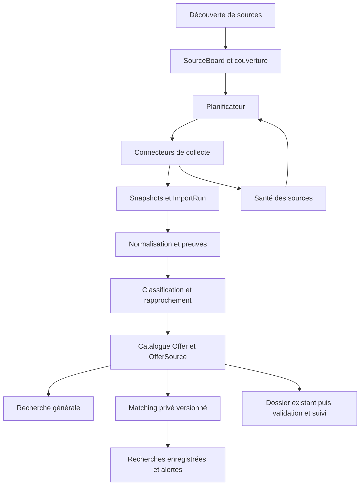

# Intern — Moteur de découverte et de vérification des stages en Europe

Date : 30 septembre 2026. Statut : **moteur et première extension de couverture implémentés ; couverture partielle**. Les bilans locaux et limites figurent en sections 14 et 15. Périmètre demandé : tous les domaines de stage en Europe.

## 1. Décision produit et références

Construire un catalogue européen commun, alimenté en continu, puis produire des recommandations personnelles expliquées. La découverte de sources, la collecte, la vérification, le matching et l'exécution de candidatures sont des capacités distinctes.

**Règle de publication précisée par l'utilisateur pendant l'implémentation : seuls les stages confirmés en Europe sont visibles dans le catalogue, le dashboard et les recommandations.** Ce périmètre est imposé côté serveur, même sans filtres et même si un client demande d'autres contrats/régions. Les données complètes des boards peuvent rester dans la zone technique d'import pour réconciliation, mais ne sont pas des offres publiées. Un type de contrat ou un périmètre européen inconnu bloque la publication ; les inconnues de durée/langue restent consultables pour une offre déjà éligible.

« Tous les stages en Europe » exprime l'ambition de couverture. Le produit affiche les sources et pays effectivement surveillés ; aucun compteur ne vaut preuve d'exhaustivité. Il ne réduit pas son catalogue à la tech ni aux stages anglophones.

Cette spec précise le moteur de découverte de [VISION.md](../produit/VISION.md). Elle ne supprime pas les autres contrats du modèle général. Le parcours **Stages Europe** sélectionne les stages ; alternances, apprentissages, emplois étudiants et graduate programmes restent des catégories distinctes. Elle conserve l'approbation individuelle, les révisions et les garanties d'envoi de [BACKEND_SPEC.md](../backend/BACKEND_SPEC.md) et de [l'ADR-001](../decisions/001-database-architecture.md).

Recherche publique actuelle : [Tsenta](../research/2026-09-30-tsenta.md), [Simplify](../research/2026-09-30-simplify.md). Les observations, déclarations éditeur et hypothèses y sont séparées. [La recherche du 28 septembre](../research/COMPETITOR_DATABASE_RESEARCH.md) apporte le contexte historique ; les rapports datés du 30 prévalent pour les faits revérifiés. Aucune inspection de serveur privé ni validation de candidature réelle n'a été effectuée.

## 2. Enseignements concurrentiels et décisions

| Convergence ou différence | Conséquence pour Intern | Priorité |
|---|---|---|
| InternHunt expose un catalogue avec filtres de région, langue, visa et métier ; Simplify distingue catalogue et sélection personnelle ; Tsenta propose découverte et préparation | Une seule offre canonique, plusieurs vues, recommandations privées liées à cette offre | P0 |
| Simplify utilise profil et préférences pour les matchs ; Tsenta documente des préférences de recherche | Profil confirmé partagé entre découverte et dossier ; calcul versionné avec raisons et inconnues | P0 |
| Simplify documente une couverture géographique limitée pour le catalogue, différente de la portée de Copilot | Afficher séparément couverture de collecte et capacité à candidater sur un portail | P0 |
| Les deux proposent préparation et suivi ; Copilot et Autopilot sont des modes distincts chez Simplify | Ne pas assimiler lien de candidature, préremplissage et soumission automatisée | P0 |
| Tsenta documente revue avant envoi et reçus ; Simplify documente aussi Autopilot, pas seulement une extension | Préserver dossier exact, accord et résultat ; automation future branchée sur ce contrat | P0 pour le contrat, exécution hors moteur |
| Simplify permet le suivi d'offres externes | Ajouter un lien privé et suivre une candidature même si la source n'est pas encore collectée | P1 |
| Tsenta expose des fiches présentant des anomalies de classification et des doublons apparents dans l'échantillon étudié | Vérifications croisées, provenance par champ, rapprochements prudents et signalement utilisateur | P0 |
| Simplify documente réponses réutilisables et plusieurs CV | Réponses confirmées avec contexte en P1 ; garder le CV courant unique prévu dans Intern et ses variantes historiques | P1/P2 |
| Email, extension, MCP et autonomie avancée étendent le produit | Ne sont pas requis pour prouver la couverture et la qualité du catalogue | P2 |

Sources des lignes concurrentielles : rapports liés ci-dessus et leurs liens primaires. Pour InternHunt, [catalogue public observé](https://internhunt.eu/jobs) le 30 septembre : filtres et offres présents dans le contenu reçu. Les affirmations horaires et sources LinkedIn/Indeed/Glassdoor ont été retrouvées sur l'accueil public ; elles restent des déclarations éditeur, pas une cadence mesurée. Les anomalies observées chez un concurrent ne permettent pas d'estimer son taux d'erreur global.

**Ajouts retenus par rapport au brainstorming :** plusieurs recherches enregistrées, feedback sur les recommandations, import privé par URL, capacité de candidature explicite, dossier avec reçu, et suivi des modifications significatives. Le noyau reste collecte, qualité et matching.

## 3. Périmètre européen et métier

### 3.1 Géographie

Décision proposée : registre versionné `EuropeScope`, avec pays/territoires et règles de localisation, indépendant des connecteurs. Inclure UE, EEE, Royaume-Uni, Suisse, Balkans, Europe orientale et micro-États. Les zones transcontinentales ne se déduisent pas du seul siège social de l'entreprise.

Liste initiale de marchés de recherche proposée : AL, AD, AT, BY, BE, BA, BG, HR, CY, CZ, DK, EE, FI, FR, DE, GR, HU, IS, IE, IT, XK, LV, LI, LT, LU, MT, MD, MC, ME, NL, MK, NO, PL, PT, RO, SM, RS, SK, SI, ES, SE, CH, UA, GB, VA ; FO et GI comme territoires explicites. XK est un identifiant opérationnel, pas présenté comme un code ISO officiel. Pour RU, TR et KZ, filtrer la localisation européenne ; pour AM, AZ et GE, conserver une extension de recherche explicitement nommée « Caucase », désactivable et sans suppression des données collectées. Cette convention produit large est une proposition, pas une définition géopolitique universelle.

- Un poste présentiel/hybride entre dans le catalogue si au moins un lieu de travail est dans le périmètre.
- Un poste distant y entre si les lieux de résidence autorisés incluent le périmètre, avec preuve ; « remote » seul ne signifie pas accessible depuis toute l'Europe.
- Si une localisation est ambiguë, conserver l'annonce dans la zone technique de vérification, sans inventer un pays ni la publier dans les recherches candidat.
- Une annonce multiville garde tous ses lieux et restrictions. Une entreprise américaine peut proposer un stage européen ; une entreprise européenne peut proposer un stage hors périmètre.

### 3.2 Domaines et langues

Pas de filtre sectoriel d'exclusion. Taxonomie initiale extensible : informatique/data, ingénierie/industrie, sciences/recherche, santé, finance/comptabilité, droit, marketing/communication, commerce, RH, design/arts, opérations/logistique, hôtellerie/tourisme, secteur public/associatif, autre/non classé.

Conserver titre, description et langue d'origine. Normaliser métiers, compétences et lieux avec alias par langue. La langue de l'annonce n'est pas automatiquement une langue exigée du candidat. La traduction est une vue dérivée, ne remplace pas le texte source et ne sert pas seule de preuve.

Classification du contrat : `internship`, catégories existantes appropriées, ou `unknown`, avec statut de validation séparé. Les mots `stage`, `intern`, `Praktikum`, `prácticas`, `tirocinio`, `staż` sont des indices, jamais une décision suffisante. `Werkstudent`, `trainee`, `co-op` et `graduate` nécessitent le contexte. Un responsable de programme de stages n'est pas un stagiaire.

## 4. Parcours utilisateur

1. Le candidat consulte le catalogue sans devoir fournir son CV. L'accès anonyme est une extension explicite du contrat actuel : uniquement données publiques ; profil et recommandations restent authentifiés.
2. Il filtre par pays/ville, domaine/métier, période de début, durée, langue requise, mode de travail, rémunération publiée et conditions explicites d'éligibilité.
3. Il peut inclure les informations secondaires inconnues, option active par défaut : durée, langue, sponsoring. Cette option ne relâche jamais la condition stage confirmé + Europe confirmée. « Visa non précisé » est différent de « sponsoring disponible » et « sponsoring exclu ».
4. Chaque carte donne source principale, première détection, dernière vérification, état de fraîcheur et capacité de candidature. Aucun score de probabilité d'embauche.
5. Dans le détail, chaque critère extrait important permet de consulter son extrait justificatif, la source et la date. Une contradiction est visible.
6. Il enregistre une recherche, choisit une fréquence d'alerte, sauvegarde une offre ou la masque. Il peut indiquer une erreur de lieu, contrat, doublon ou fermeture.
7. Une offre propose « Préparer ma candidature » si le parcours est disponible, sinon « Ouvrir le site employeur ». Cliquer ce lien ne crée jamais un succès d'envoi.
8. Une offre fermée reste consultable depuis les favoris et dossiers historiques, avec avertissement et préparation désactivée ; le flux courant ne l'affiche pas.

P1 : coller un lien crée une entrée privée immédiatement, puis une tentative d'extraction asynchrone. Un échec conserve le lien et les champs manuels. Une URL privée/personnalisée n'entre jamais automatiquement dans le catalogue global.

Actions complémentaires reprises de Simplify : masquer une entreprise, annuler ce masquage, et indiquer « J'ai déjà postulé ». Cette dernière action est une déclaration utilisateur datée ; elle ne fabrique ni reçu d'envoi ni succès d'un run technique. Les exclusions d'entreprise sont privées, explicites et consultables dans les préférences.

## 5. Architecture et contrats



Monolithe Django/DRF, PostgreSQL, stockage des snapshots ; processus séparés pour planification, imports et enrichissement. Réutiliser la structure d'outbox existante avec consommateurs par sujet. Le worker d'envoi actuel reste isolé : il traite `application.submit` et n'est pas déjà un worker générique de collecte.

Sujets proposés : `source.discover`, `board.sync`, `source.normalize`, `offer.enrich`, `match.refresh`, `alert.deliver`. Réseau hors transactions ; une réservation de tâche et les écritures finales sont transactionnelles. Un token de lease empêche un worker dépassé de publier son résultat. Une seule synchronisation active par board ; une exécution plus ancienne ne remplace jamais une plus récente.

### 5.1 Découverte des sources

Entrées : registre initial multi-pays/multi-domaines, ajout opérateur, suggestions d'utilisateurs, recherches publiques périodiques par marché et secteur. Sortie : candidat de source avec URL, méthode de découverte, entreprise pressentie, provider détecté et date.

Validation : identité entreprise/domaine, page publique, identifiant de board, collecte pilote et provenance. États : `candidate → validated → enabled`, ou `rejected/paused`. Détection répétée idempotente par provider/instance/board_key. Un lien d'agrégateur peut conduire à découvrir la page employeur, mais ne devient pas automatiquement une nouvelle entreprise validée.

La découverte peut s'arrêter sans interrompre la surveillance du registre connu. Prioriser les sources apportant des annonces uniques dans des couples pays/domaine peu couverts, pas leur seul volume.

### 5.2 Collecteurs

Ordre de préférence : API publique documentée, données structurées `JobPosting`, HTML public, navigateur automatisé ciblé. [Greenhouse](https://docs.greenhouse.io/job-board.html), [Ashby](https://developers.ashbyhq.com/docs/public-job-posting-api) et [Lever](https://github.com/lever/postings-api) sont les premiers contrats à intégrer ; ils nécessitent un board identifié et ne fournissent pas un index mondial d'entreprises. [JobPosting](https://schema.org/JobPosting) définit des champs utiles, sans garantir que chaque site les remplit correctement.

Interface proposée :

```python
discover(board) -> BoardIdentity
fetch(board, checkpoint=None) -> FetchResult
normalize(snapshot) -> list[NormalizedPosting]
check(posting) -> SourceCheck
```

`FetchResult` contient identifiant de run, pages collectées, curseur éventuel, indicateurs de complétude, total annoncé si disponible, snapshots et erreurs. `NormalizedPosting` contient identité d'origine, URL d'origine/candidature, entreprise, contenu, localisation brute, champs fournis et hash. `SourceCheck` retourne `active`, `closed`, `missing` ou `unknown`, sa preuve et sa date.

Une réponse partielle peut alimenter des mises à jour positives après validation par annonce ; elle ne déclenche jamais de traitement des absents. La V1 Greenhouse garde sa règle actuelle plus stricte : tout le snapshot validé ou aucun changement.

### 5.3 Planification

Valeurs initiales proposées, configurables : sources structurées prioritaires toutes les 2 h, autres sources toutes les 6 à 24 h, découverte quotidienne. Ajouter jitter, budget de requêtes par domaine, respect de `Retry-After` et backoff exponentiel borné. Les annonces inchangées mettent à jour la date de vérification, sans relancer l'IA.

Après cinq erreurs consécutives : circuit temporairement ouvert et alerte opérateur ; tentative de récupération différée. Un blocage d'accès reste une indisponibilité, pas une fermeture. Les limites d'une source priment sur la fréquence cible. Aucun SLA universel horaire n'est annoncé.

## 6. Qualité, provenance et durée de vie

### 6.1 Extraction et IA

Pipeline : champs structurés → règles par langue → extraction IA bornée pour champs manquants/ambigus → validation du schéma et des citations → publication ou vérification.

Chaque fait extrait porte `field`, `value`, `source_revision_id`, `evidence_text` ou chemin JSON, `method`, `extractor_version`, `observed_at` et `confidence`. La confiance est un signal interne, pas une probabilité d'éligibilité. Vérifier que l'extrait existe dans le snapshot. Les sorties sans preuve restent inconnues. La priorité d'une correction humaine est persistante et son auteur/raison sont audités.

Champs stage : début exact ou intervalle, durée et unité originales, échéance, niveau/formation, année de diplomation, inscription scolaire/convention si explicitement demandée, langue et niveau, contraintes de résidence/travail et sponsoring. Ne pas transformer « été 2027 » en une date précise ni confondre résidence, nationalité et autorisation de travail.

Appeler l'IA uniquement sur nouvelles versions de contenu utile ; clé idempotente `(semantic_hash, extractor_version)`. Garder séparément hash du payload brut et hash du contenu sémantique : un timestamp technique qui change ne doit pas relancer l'extraction. Budget quotidien plafonné ; en cas d'épuisement, conserver le contenu et les champs déterministes avec état « enrichissement en attente ».

### 6.2 Déduplication

1. Unicité source : `(board_id, external_id)`.
2. Rapprochement certain : URL employeur canonique ou identifiant de réquisition dans le même espace employeur, avec vérification de cohérence.
3. Rapprochement probable : entreprise résolue, titre normalisé, lieux, dates, description similaire. Créer un candidat de fusion ; ne pas fusionner automatiquement sur le titre seul.
4. Conserver toutes les publications et leurs preuves. Choisir la source employeur pertinente comme référence ; un conflit reste explicite et ne se résout pas par « dernière écriture gagnante ».

Les fusions sont auditables et réversibles. Préserver IDs accessibles via alias, favoris et historique ; ne pas réécrire les snapshots de candidatures. Deux réquisitions distinctes ne fusionnent pas parce qu'elles ont le même titre. Une réouverture garde l'identité si la réquisition est la même ; un nouvel identifiant est réévalué.

### 6.3 Fermeture et fraîcheur

Deux axes distincts : disponibilité de l'offre (`open/closed/hidden`) et fraîcheur (`fresh/stale/unknown`). Ne pas ajouter `stale` à `Offer.status` sans migration explicite.

- Source explicitement fermée ou échéance sourcée dépassée : fermer cette publication. Un HTTP 200 générique ne prouve pas que l'offre est ouverte ; une redirection vers l'accueil non plus.
- Absence après snapshot complet : marquer `missing`. Par défaut, confirmer sur deux imports complets espacés d'au moins 6 h avant fermeture ; un connecteur peut fermer dès le premier uniquement si son contrat de complétude et d'autorité est validé.
- Timeout, 403, 429, challenge, pagination incomplète, parsing échoué : aucune fermeture par absence.
- Snapshot vide ou chute de plus de 50 % pour un board ayant au moins 20 annonces : mettre la réconciliation destructive en attente de confirmation, même si le JSON paraît valide.
- Si la source employeur indique explicitement une fermeture, une copie d'agrégateur ancienne ne maintient pas l'offre ouverte. Si plusieurs sources employeur se contredisent, marquer conflit et suspendre les alertes jusqu'à vérification.
- À défaut de source autoritaire, fermer l'offre seulement quand toutes ses sources utiles sont fermées/absentes confirmées. Une source en panne peut rendre la fraîcheur inconnue sans prouver la fermeture.
- Source non revérifiée après `max(2 × cadence, 24 h)` : `stale`, date visible. Exclure des alertes ; après sept jours sans preuve récente, retirer du flux par défaut sans effacer l'historique.

Ces règles remplacent explicitement la fermeture actuelle immédiate après une absence Greenhouse. L'état `hidden` posé par modération ne doit jamais être rouvert par un import.

## 7. Matching et recherches enregistrées

Séparer **conditions obligatoires** et **préférences de classement**. Toute exigence utilisée doit avoir une preuve et un caractère obligatoire/préféré. Le candidat confirme ses disponibilités, durées, langues et autorisations ; l'import de CV ne les confirme pas automatiquement.

Résultat principal :

- `compatible_known` : aucune contradiction sur les critères connus, sans garantie d'admission.
- `needs_verification` : condition importante inconnue, ambiguë ou contradictoire entre sources.
- `incompatible_explicit` : contradiction entre condition obligatoire explicite et fait candidat confirmé.

Une information absente ne vaut ni « non » ni rejet. Une compétence simplement souhaitée ne devient pas un filtre bloquant. Le moteur ne déduit pas un droit au travail de la nationalité ; il compare les déclarations confirmées et les exigences de l'annonce.

Après cette classification : classer par correspondance métier, préférences géographiques, compétences pertinentes et fraîcheur. Afficher les raisons concrètes ; pas de « 87 % de chances ». Sans profil, recherche générale par pertinence textuelle/date. Une recherche libre ne doit pas dépendre de préférences complètes.

Le code actuel de `recommendations/` renvoie une liste vide lorsque les contrats ou modes acceptés ne sont pas configurés. À faire évoluer : retourner un état d'onboarding incomplet et un catalogue non personnalisé accessible ; ne pas laisser croire qu'aucun stage n'existe. Pour les recherches multilingues, appliquer les alias validés de métiers/compétences et lieux à la requête, tout en laissant chercher le titre original ; la configuration PostgreSQL `simple` seule ne traduit pas les termes.

Stocker/cache par `(user, offer, offer_version, profile_version, search_version, matcher_version)`. Un changement de contenu, profil ou préférences invalide le résultat. Recalculer seulement les candidats concernés via présélection SQL, jamais toutes les paires utilisateurs × offres après chaque import.

Plusieurs `SavedSearch` par utilisateur : critères, politique d'inconnus, rythme `off/daily/immediate`, fuseau et dernière évaluation. V1 : digest quotidien et centre de notifications dans l'application ; `immediate` reste désactivé jusqu'à disponibilité du canal. Email est un canal ultérieur activable après configuration et opt-in ; Telegram n'est pas une dépendance.

Événements alertables : nouvelle offre pertinente, réouverture confirmée, modification significative rendant une offre pertinente. Un changement de casse ou de tracking URL ne crée pas d'alerte. Au premier enregistrement d'une recherche, afficher les résultats existants comme référence sans envoyer tout l'historique. Clé d'unicité interne `(user, canonical_offer, event_version, channel)` pour éviter les doublons entre recherches et sources. Les livraisons externes utilisent une clé fournisseur si disponible ; un résultat externe incertain est conservé, pas présenté comme une garantie d'exactement une fois.

Feedback privé : `not_interested`, `wrong_role`, `wrong_location`, `not_internship`, `already_applied`, commentaire facultatif. Masquer uniquement pour l'utilisateur ; une correction globale passe par modération. Les données privées de candidature ne servent pas à modifier silencieusement la vérité publique d'une offre.

## 8. Évolution du modèle existant

État observé dans le code le 30 septembre ; aucune preuve runtime nouvelle ni test applicatif exécuté pour cette spec. Le paragraphe initial de BACKEND_SPEC décrit un état antérieur : le checkout contient désormais API et import Greenhouse.

| Élément existant | Constat de lecture | Évolution proposée |
|---|---|---|
| `Company`, `Location`, `Role`, `Skill`, `Offer` | Catalogue relationnel, multilocalisation, recherche PostgreSQL `simple` | Alias multilingues, domaines, projection des contraintes stage, `content_version` et fraîcheur |
| `SourceBoard` | Provider/instance/board, état activé, dernière réussite, mode d'envoi | Cadence, prochaine exécution, santé, statut de découverte, périmètre, budget et autorité |
| `ImportRun` | running/succeeded/failed, total, snapshot complet | Checkpoint, complétude détaillée, compteurs et raison de quarantaine ; `partial` nécessite migration |
| `OfferSource` | Identité stable, raw payload mutable, hash, dates et états | Révisions immuables des changements, fermetures confirmées, empreinte sémantique |
| `CompensationBand` | Devise, période, brut/net, source | Réutiliser ; aucune conversion implicite et aucune rémunération estimée présentée comme publiée |
| `CandidateProfile`, `WorkAuthorization`, `SearchPreference` | Profil versionné, disponibilité, autorisations par pays, préférences uniques | Durée/disponibilité de fin, langues et contraintes confirmées ; recherches multiples séparées |
| `SavedOffer`, dossiers et révisions | Favoris privés et historique de candidature | Réutiliser ; ajouter feedback et liens externes privés sans casser les FK |
| `OutboxMessage` | Déduplication, lease, topic | Nouveaux consommateurs par topic, pas de changement de sémantique d'envoi |

Nouveaux objets minimaux proposés :

- `SourceCandidate` : URL normalisée, provenance de découverte, statut et source validée éventuelle.
- `SourceRevision` : source, hash, contenu/snapshot ou référence de stockage, date, version connecteur ; unique `(source, raw_hash)`.
- `OfferFact` : champ et valeur typée, révision source, preuve, méthode/version, confiance, statut et éventuelle correction. Les champs filtrables fréquents sont aussi projetés en colonnes/index ; pas de filtrage intégral dans du JSON.
- `OfferMergeDecision` : deux offres, décision, preuves, auteur, date, alias et éléments nécessaires au retour arrière.
- `SavedSearch`, `OfferFeedback`, `Recommendation` et `AlertEvent` : tous privés et liés au propriétaire ; contraintes d'unicité suivant les contrats ci-dessus.
- `CompanyPreference` : utilisateur, entreprise et exclusion explicite, unique `(user, company)` ; priorité sur le classement, sans supprimer l'entreprise du catalogue commun.
- P1 `ExternalOpportunity` : propriétaire, lien privé et champs manuels, état d'extraction, offre canonique éventuellement associée. Ne pas rendre `Application.offer` nullable sans conception de migration dédiée.

Implémenter par migrations additives, backfill borné et reprise des IDs/FK existants. Les données historiques restent `unknown` lorsque la preuve manque. Documenter toute extension dans DATABASE_SCHEMA et API lors de l'implémentation, pas en annonçant ces migrations comme livrées.

## 9. Contrat API proposé

Conserver `/api/v1/`, formats d'erreur et pagination DRF existants. Ajouts compatibles aux routes de lecture ; les nouveaux filtres sont validés et bornés. La capacité d'envoi est calculée côté serveur depuis l'adaptateur effectivement activé, pas seulement depuis une chaîne enregistrée.

| Route | Fonction |
|---|---|
| `GET offers/` | Filtres existants + country, domain, start_from/start_to, duration_min/duration_max/duration_unit, required_language, include_unknown, freshness ; parcours Europe stage explicite |
| `GET offers/<id>/` | Champs normalisés, preuves publiques limitées, dates, sources et capacités ; détail fermé accessible avec état explicite |
| `GET recommendations/` | Ajouter état de compatibilité, raisons, inconnues et versions ; garder les anciens champs pendant transition |
| `GET/POST saved-searches/` | Lister/créer recherches privées |
| `GET/PATCH/DELETE saved-searches/<id>/` | Modifier critères/notifications et version ; propriétaire uniquement |
| `PUT/DELETE offers/<id>/feedback/` | Feedback privé idempotent ; DELETE rétablit l'offre dans la vue personnelle |
| `PUT/DELETE company-preferences/<company_id>/` | Masquage privé et réversible d'une entreprise |
| `POST offers/<id>/reports/` | Signalement privé à la modération ; aucune fermeture publique automatique |
| `GET alerts/` et `POST alerts/<id>/read/` | Alertes privées et lecture |
| `GET coverage/` | Pays/domaines suivis, dates, sources actives et limites ; ni secrets ni erreurs brutes |
| P1 `POST external-opportunities/` | Crée lien privé, retourne 202 avec ID et statut d'extraction ; pas de fetch synchrone arbitraire |

Filtres de durée : `duration_unit=days|weeks|months` obligatoire si une borne est fournie ; bornes positives et min ≤ max. Conserver l'unité source. Convertir semaines/jours exactement ; comparer les mois calendaires entre eux ou calculer depuis des dates exactes lorsque possible. Un stage « 6 mois » n'est pas automatiquement 180 jours : une comparaison non justifiable devient inconnue et suit `include_unknown`, sans décision bloquante inventée.

## 10. Exploitation, sécurité et coûts

- Imports partagés : aucun crawl complet par utilisateur. Mesurer requêtes, annonces nouvelles uniques, temps CPU/navigateur et coût IA par source.
- Endpoints documentés et hôtes fixes pour les API. Pour une URL découverte/importée : HTTPS, blocage des IP privées/locales/métadonnées, revalidation DNS et redirections, nombre de redirections limité, durée/taille bornées. Aucun cookie ou secret utilisateur envoyé à une source publique.
- Respecter les limites d'accès des sources ; mettre en attente celles qui exigent une session/autorisation spécifique. Pas de contournement de CAPTCHA ou de connexion.
- HTML assaini pour affichage ; contenu des annonces traité comme données non fiables. L'extracteur IA n'exécute aucune instruction contenue dans une annonce et n'a pas accès aux CV, secrets ou outils d'envoi.
- Catalogue global séparé des profils, feedback, recherches et dossiers privés. Pas de nationalité, identité sensible ou contenu de messagerie utilisé pour apprendre un classement global.
- Proposition de conservation : payloads bruts 30 jours, puis métadonnées/hashes et seuls extraits nécessaires à la traçabilité ; les snapshots de candidature suivent la politique privée existante. Prévoir purge configurable et conservation différenciée selon la source. Cette proposition technique n'est pas une politique juridique validée.
- Kill switch par connecteur, pause découverte, pause IA et replay depuis snapshots. Une panne d'enrichissement n'arrête pas les imports fiables ; une panne de collecte n'efface pas le catalogue.
- Hypothèse de charge pour un pilote : 1 000 boards à 4 imports/jour représentent 4 000 imports/jour, avant pagination, détails et reprises. Mesurer le coût réel ; le nombre de requêtes n'est pas égal au nombre d'importations.

## 11. Recette et critères de livraison

Constituer un corpus annoté de départ d'au moins 500 annonces, couvrant au moins 10 pays, 8 langues et 10 familles métier, dont au moins 150 faux amis/négatifs. Doubles annotations sur les cas ambigus. Garder un lot de contrôle séparé des exemples utilisés pour régler règles/prompts. Ces volumes sont des objectifs de recette, pas une couverture déjà acquise.

| Cas | Résultat attendu |
|---|---|
| Même snapshot importé deux fois | Aucune offre/alerte supplémentaire |
| Deux workers, run ancien terminé après le nouveau | Une publication cohérente ; résultat ancien rejeté |
| API partielle, 429, erreur, page HTML de challenge | Aucune fermeture par absence |
| Board soudain vide | Réconciliation destructive suspendue, diagnostic visible |
| Fermeture employeur et copie agrégateur ancienne | Offre non présentée comme ouverte grâce à cette copie |
| Stage multiville / même titre avec deux réquisitions | Lieux conservés / offres distinctes |
| Poste de responsable des stages, mot « internship » dans la description | Non publié comme stage confirmé |
| Offre allemande avec durée explicite ; offre française sans durée | Valeur prouvée / inconnue préservée |
| Télétravail limité au Royaume-Uni | Pas de compatibilité automatique depuis la France |
| Sponsoring absent, langue de description anglaise | Ni sponsoring refusé ni anglais obligatoire inventé |
| Profil modifié après calcul ; offre modifiée après accord | Matching invalidé ; règles de candidature existantes conservées |
| Offre fusionnée et retrouvée par deux recherches | Un résultat canonique, pas deux alertes internes |
| Lien privé en import, accès par un autre utilisateur | Refus/404 ; aucune donnée injectée dans le catalogue public |
| Prompt malveillant ou URL locale dans l'annonce | Aucun outil exécuté ni accès réseau interne |
| Offre fermée déjà sauvegardée/candidature existante | Historique conservé, pas de nouvelle préparation trompeuse |

Seuils proposés sur le corpus de contrôle : précision « stage confirmé » ≥ 97 %, rappel ≥ 90 % ; publier effectifs et résultats par langue/domaine, pas seulement moyenne. Chaque fait obligatoire utilisé pour exclure possède une preuve, objectif 100 %. Faux regroupements automatiques : aucun sur les cas de contrôle ; passer en revue manuelle si l'identité reste incertaine.

Métriques en service : p50/p95 du délai de détection sur sources connues, taux de vérification dans la fenêtre propre à chaque source, proportion stale, liens employeurs encore ouverts sur échantillon, doublons, couverture pays × domaine, coût par nouvelle offre utile, alertes répétées et signalements résolus. Aucun « taux de couverture de tous les stages » sans dénominateur vérifiable.

Cible de performance pilote : catalogue et recommandations p95 < 1 s côté serveur sur jeu de 100 000 offres et 20 requêtes concurrentes, environnement de mesure consigné. Objectif de conception à mesurer, pas résultat acquis. Aucun choix de moteur vectoriel ou moteur de recherche externe avant diagnostic de la recherche PostgreSQL.

## 12. Lots d'implémentation

| Lot | Livrable | Dépendances et sortie vérifiable |
|---|---|---|
| A | Registre, contrat connecteur, révisions et santé des sources | Import Greenhouse existant adapté ; réimport et échec non destructif prouvés |
| B | Ashby, Lever, planification et collecte mutualisée | A ; corpus de boards variés, métriques par pays/domaine, backoff et concurrence vérifiés |
| C | Classification multilingue, géographie, faits sourcés, fusion prudente et fermeture | A ; corpus annoté et seuils de recette ; B élargit la recette réelle |
| D | Recherche Europe et matching expliqué, profils/préférences complétés | C ; scénarios de compatibilité et inconnues validés |
| E | Recherches enregistrées, alertes internes, feedback et tableau de couverture | B + D ; déduplication/reprise et isolation utilisateur prouvées |
| F | Import privé par URL et sources spécialisées nationales | A + C ; validation réseau et provenance, gain de couverture mesuré |
| G | Branchements candidature et reçu | Contrat D + backend existant ; capacités réelles activées séparément, aucune soumission réelle nécessaire à la recette moteur |

Le catalogue de lancement doit comporter plusieurs pays et domaines ; une collecte uniquement tech ne satisfait pas le périmètre. L'ouverture de nouvelles langues se fait avec mesure de qualité et état de couverture visible, sans inventer une prise en charge complète.

Hors lots A–E : extension navigateur, synchronisation Gmail, MCP public, auto-application sans revue, facturation, CV multiples courants, conseils d'entretien, garantie sur tous les ATS. Ce sont des extensions possibles issues du benchmark ; aucune n'est nécessaire pour livrer le moteur demandé.

Déploiement progressif : flags par connecteur/enrichisseur, import parallèle d'observation avant publication, activation sur boards pilotes, élargissement après recette. Rollback : arrêter planification et consommateurs concernés, revenir aux projections antérieures, conserver snapshots/IDs/dossiers ; aucune réinitialisation de PostgreSQL.

## 13. Arbitrages proposés restant à mesurer

Le périmètre « tous domaines, Europe » est décidé par l'utilisateur. Les cadences, seuils, convention géographique détaillée, rétention et tailles de corpus de ce document sont des valeurs proposées. Le fournisseur d'extraction IA, le budget quotidien, les sources nationales prioritaires et le canal email seront choisis sur pilote documenté. Aucun achat, connexion de compte ou envoi externe n'est requis pour commencer le lot A.

## 13 bis. Priorité de couverture après audit InternHunt

L'[audit public InternHunt](../research/2026-09-30-internhunt-coverage.md) montre environ 6 600 annonces dans ses régions européennes contre 159 annonces admissibles dans notre pilote. Les périmètres diffèrent (emplois étudiants/apprentissages/programmes diplômés présents chez InternHunt), mais notre découverte reste nettement insuffisante. Le pilote n'est pas la livraison de l'ambition « tous les stages en Europe ». Cette section définit la cible de l'extension. La section 15 distingue les éléments maintenant implémentés des sources et mesures encore manquantes.

### Collecte prioritaire avant nouvelles fonctions de matching

| Lot | Travail concret | Preuve de sortie |
|---|---|---|
| Couverture 1 | Introduire des recherches de découverte persistées pays × langue × domaine × fenêtre de publication, avec requête, source, curseur, nombre de résultats, plafond, date, statut et preuve. Distinguer découverte de nouveaux employeurs et actualisation des boards connus | Un cycle découvre des employeurs absents du registre, consigne les requêtes tronquées et reprend sans doublonner |
| Couverture 2 | Ajouter Personio et Recruitee ; accepter au registre les sources détectées non encore supportées (Workday, SuccessFactors, Taleo, iCIMS, site propre), sans les faire disparaître comme URL invalide | Imports réels vérifiés, statut explicite pour fournisseur non supporté, preuve de l'URL employeur et test d'activation |
| Couverture 3 | Piloter un flux transversal accessible (Arbeitnow) et un flux national officiel (JobSearch Suède), plus une expérience bornée de découverte via grands sites d'emploi | Provenance et attribution conservées, lieux/contrats revalidés, quotas et erreurs explicites. Aucune API partenaire annoncée branchée sans accès obtenu |
| Couverture 4 | Prioriser les grands ATS et portails nationaux selon les stages manqués du panel, pas selon la facilité d'ajouter un énième board de startup | Liste des stages de référence récupérés et toujours manqués, ventilée par domaine et pays |
| Couverture 5 | Résoudre les villes avec preuves et contexte ; isoler les fiches contradictoires sans bloquer indéfiniment un employeur entier | Tests homonymes/multilieux ; annonces valides importables, fiche invalide en quarantaine, aucune fermeture déduite d'un détail en échec |

Les [sources et conditions d'accès vérifiées](../research/2026-09-30-europe-coverage-strategy.md) déterminent les essais possibles. EURES, JobTeaser et WTTJ ne sont pas présumés fournir un export global libre. JobSpy est une option d'expérience, pas une dépendance déjà validée ni un outil attribué à InternHunt.

### Contrats de découverte et reprise

- La matrice couvre les pays de la section 3, avec termes locaux de stage et domaines diversifiés. Les premiers pays de recette ne deviennent pas une limite géographique du produit. Une requête atteignant un plafond se subdivise par date/région/domaine ; son état ne devient jamais « complet » par défaut.
- Toute source nouvelle conserve `discovered_from`, `discovered_at`, URL canonique, entreprise présumée, fournisseur, droits/conditions d'accès connus et résultat du pilote. La validation d'un connecteur n'autorise pas à publier un contrat ou un lieu incertain.
- La géolocalisation utilise d'abord le pays structuré, puis une ville et ses indices explicites (région, adresse, page employeur). Les villes homonymes sans corroboration restent en attente. Les lieux d'un siège ne remplacent jamais ceux du poste.
- Pour les anomalies comme Bosch : différencier succès de pagination, identifiants vus et résultat de chaque détail. Une fiche incohérente reste en quarantaine avec dernière donnée fiable ; elle ne ferme ni ne valide une autre fiche. Les erreurs globales de pagination interdisent toute déduction d'absence. Ce mécanisme doit être testé avant de remplacer le snapshot entièrement atomique actuel.
- Cadences adaptatives, budgets par domaine et backoff ; collecte incrémentale récente complétée par réconciliation périodique. Le worker de découverte et les collecteurs doivent être effectivement exécutés et supervisés ; leur présence dans le dépôt ne suffit pas.

### Recette du changement d'échelle

Constituer le corpus indépendant de 500 annonces prévu en section 11, réparti entre plusieurs pays, langues et domaines, depuis des sources employeurs qui ne sont pas choisies seulement parce que notre moteur les supporte déjà. Pour chaque stage actif manqué, enregistrer une cause : source inconnue, fournisseur non supporté, limite de recherche, erreur réseau, contrat, géographie, fraîcheur ou déduplication. Publier les effectifs et le rappel par strate avec leur incertitude.

Le compteur de stages doit croître par ajout de sources et correction des faux négatifs, jamais par inclusion d'emplois hors Europe ou hors stage. Un objectif de capacité en milliers de sources est un jalon d'ingénierie à tester ; ce n'est pas une garantie d'exhaustivité ni un nombre de stages attendu inventé.

## 14. Livraison et vérification locale — 30 septembre 2026

### Implémentation livrée

Le moteur s'appuie sur le Django/PostgreSQL existant : registre de sources, connecteurs publics Greenhouse/Ashby/Lever/SmartRecruiters, snapshots et observations, planification avec baux et reprise, extraction déterministe de faits sourcés, publication filtrée, matching explicable, recherches enregistrées, alertes internes, feedback et import privé par URL. Le frontend expose les filtres, les preuves, la fraîcheur, les recherches enregistrées et l'état de couverture. Les rapprochements prudents disposent d'un audit et d'une commande de retour arrière.

La règle de publication est obligatoire côté serveur : **stage confirmé ET localisation européenne attestée**. Un paramètre de recherche ne permet pas de la contourner. Les inconnues de contrat ou de géographie ne sont pas publiées ; l'option des critères inconnus porte seulement sur les critères secondaires. Les anciennes sauvegardes privées conservent leur historique. Les descriptions ou bureaux du siège ne prouvent pas à eux seuls le lieu du poste. Les titres explicites d'apprentissage/alternance priment sur un champ ATS `intern` incorrect.

Les migrations additives 0017 à 0020 sont appliquées dans la base locale. Une sauvegarde préalable est conservée hors dépôt dans `/Users/omarbenjelloun/.codex/backups/intern-engine-20260930/before-engine.dump`. Aucun volume ni dossier candidat n'a été réinitialisé. Le serveur local utilisé par l'interface a été redémarré avec le code courant ; aucun déploiement distant n'est revendiqué.

### Limites réelles

- L'ambition « tous les stages en Europe » décrit la cible, pas une exhaustivité atteinte. Le compteur public compte les annonces admissibles collectées, pas tout le marché. Le pilote initial de quatre entreprises ne publiait que quatre stages ; ce résultat a motivé l'extension du registre.
- L'extraction actuelle utilise des règles et des données ATS structurées. Aucun fournisseur IA n'est configuré. Le corpus annoté de 500 annonces, les objectifs de précision/rappel, le test de charge de 100 000 annonces et les SLA de découverte restent à mesurer.
- Les lieux sans pays explicite ni corroboration fiable restent inconnus. Les bureaux associés à une entreprise peuvent être plus larges que le lieu réel du poste. Un stage télétravaillé sans pays de résidence admissible reste exclu. Cette prudence réduit le rappel.
- La découverte HTML part de domaines explicitement autorisés, avec pagination et budgets bornés. Elle ne parcourt pas tout le Web. Le résolveur DNS système reste soumis à ses propres délais ; les connexions HTTP sont ensuite contrôlées et limitées.
- La présence dans un board public vérifié récemment atteste la présence dans cette source, pas une confirmation humaine que le recrutement continue. Les traductions et annonces proches peuvent rester séparées lorsque la fusion n'est pas suffisamment sûre.
- Les alertes sont internes à l'application. Aucun email, message Telegram, candidature réelle ni soumission ATS n'a été envoyé. L'activation d'un connecteur de collecte ne constitue pas une capacité de candidature automatique.

Le [runbook](../exploitation/INTERNSHIP_ENGINE_RUNBOOK.md) donne les commandes d'exploitation et le [registre vérifié](../research/2026-09-30-europe-source-registry.md) documente les sources ajoutées. Les modifications locales restent non commitées avec le travail préexistant du dépôt.

### Contrôles réalisés

- Suite backend complète : `TEST_DATABASE_NAME=test_intern_engine_release uv run python manage.py test jobboard --noinput` — **201 tests réussis** après les corrections de publication, géographie, apprentissage et SmartRecruiters.
- Frontend : build de production réussi ; neuf tests E2E dashboard/moteur réussis lors du branchement initial, puis trois tests moteur après les ajustements des filtres et libellés. Vue desktop et mobile 320 px inspectées.
- `manage.py check` : zéro problème ; `makemigrations --check --dry-run` : aucune migration manquante ; configuration Compose valide ; lint ciblé du moteur et des connecteurs réussi.
- Régression live Greenhouse/IMC : les fiches Chicago et Sydney n'héritent plus du bureau Amsterdam ; l'offre Amsterdam conserve son pays NL. La réparation par réimport est couverte par un test.
- Régression SmartRecruiters : un apprentissage marqué `intern` est exclu ; un vrai stage étiqueté `Full-time` peut être confirmé par son texte. La section vidéo optionnelle ne fait plus échouer le board Bosch.


### Mesure du catalogue servi à l'interface

Contrôle du 30 septembre 2026 à 19:23 UTC sur l'API locale `127.0.0.1:8000`, toutes les pages parcourues : **159 annonces admissibles**, **11 employeurs avec résultats publiés**, **11 pays européens représentés**. Le registre contient 17 boards, dont 16 importés avec succès ; une source enregistrée ne garantit pas qu'une annonce passera les critères de publication. La base technique contient 1 561 offres, incluant des emplois et lieux hors périmètre conservés pour la collecte mais non publiés.

| Employeur | Annonces publiées |
|---|---:|
| Sopra Steria | 76 |
| Ubisoft | 27 |
| Accor | 19 |
| Doctolib | 16 |
| IMC | 6 |
| Presidents Institute | 5 |
| Maven | 4 |
| Joko | 2 |
| Stripe | 2 |
| CERN | 1 |
| Human Rights Watch | 1 |

Pays représentés : Suisse, Allemagne, Danemark, Espagne, France, Royaume-Uni, Irlande, Italie, Pays-Bas, Norvège et Pologne. Une annonce peut avoir plusieurs lieux ; les compteurs par pays ne s'additionnent pas en un total de postes uniques. Les annonces traduites ne sont pas arbitrairement fusionnées. La collecte reste fortement concentrée sur la France et certains employeurs.

Les 159 objets publics satisfont la classification `confirmed` et la géographie `in_scope`. Une requête demandant explicitement des non-stages hors Europe, même avec les inconnues incluses, renvoie zéro résultat. Cette vérification porte sur les invariants du moteur ; elle ne remplace pas le corpus annoté de précision/rappel restant à constituer.

Le pilote Bosch a échoué avec `snapshot_changed` après une première correction de format ; aucun lot partiel n'a été publié et aucune fermeture n'a été déduite de cet échec. Les autres imports SmartRecruiters (Accor, Ubisoft, Sopra Steria, CERN) ont réussi. Le problème de source est conservé comme erreur opérationnelle, sans gonfler le catalogue.

Diagnostic Bosch en lecture seule : la fiche `744000130841037`, « Técnico en Ingeniería de procesos » à Madrid, sort du périmètre au moment de la lecture du détail (`permanent` / `Full-time`, aucun signal stage dans le titre) alors que le résumé l'avait sélectionnée. Le connecteur maintient donc son refus du snapshot incohérent. [Fiche source](https://api.smartrecruiters.com/v1/companies/BoschGroup/postings/744000130841037).


### Complément de recherche après le pilote

Le 30 septembre, audit direct d’InternHunt et comparaison de couverture ajoutés en section 13 bis. Observation : 12 311 annonces globales, 6 612 dans les cinq régions européennes, 12 titres hors définition stricte du stage parmi les 50 premières lignes européennes. Ce dernier échantillon n’est pas représentatif du catalogue complet. Cette passe modifie la recherche et la spec uniquement : aucun nouveau connecteur, import massif ou gain de couverture n’est revendiqué.


## 15. Livraison de l'extension de couverture — 30 septembre 2026

### Code livré et exécuté

- **Sept familles ATS** : Greenhouse, Ashby, Lever, SmartRecruiters, Personio, Recruitee et Workday. Personio utilise le XML public et les données JSON-LD de la fiche pour corroborer pays/description. Recruitee dispose d'un repli XML public. Workday utilise des pages carrières publiques par employeur et leurs facettes pays observées ; le plafond global de 2 000 résultats n'est pas assimilé à une liste complète.
- **Découverte persistante** : `DiscoveryQuery` et `DiscoveryResult`, curseurs, troncature, provenance, requêtes, priorités de résolution, backoff et baux. Seize requêtes initiales réellement configurées : un flux Arbeitnow transversal, quinze requêtes JobSearch en Suède. Les autres pays ne sont pas présentés comme disposant d'un flux national opérationnel.
- **Activation après validation** : les candidats ATS reconnus peuvent être importés automatiquement, au maximum trois par passage, après configuration opérateur. Les erreurs reprennent après backoff, les candidats non encore tentés passent avant les réessais, et le bail est renouvelé avant les imports longs. Les fournisseurs non supportés restent visibles ; les URLs fournisseurs génériques et tableaux d'administration sont rejetés.
- **Résilience par annonce** : snapshots partiels avec diagnostics durables sur `ImportRun`. Les détails valides sont importés, les échecs ne rafraîchissent pas leurs anciennes annonces, aucune fermeture n'est déduite d'un lot incomplet. Le cas Bosch qui bloquait tout le board ne bloque plus les autres stages.
- **Rappel lexical corrigé** : extracteur `rules-5`, notamment Pflichtpraktikum, Stagista/Tirocinante et les titres Stage corroborés par des expressions françaises explicites dans la description. Les exclusions d'apprentissage, emploi étudiant et faux amis restent prioritaires. Aucun pays n'est inventé à partir d'une ville ambiguë.
- **Exploitation locale** : migrations 0021 et 0023 présentes/appliquées ; la migration 0022 des logos provenant d'une autre tâche a été préservée. Le worker local `run_catalogue_worker --poll-interval 30 --limit 2` est démarré. Les flux, boards et échéances sont en base ; le processus local doit rester lancé. Aucun déploiement distant ni garantie d'exécution après arrêt de la machine n'est annoncé.

Sauvegarde préalable : `/Users/omarbenjelloun/.codex/backups/intern-coverage-20260930/before-coverage.dump`. Les données existantes et les modifications des autres tâches ont été préservées. Trois candidats créés lors de cette passe et pointant vers des pages génériques/admin Teamtailor ont été retirés après correction du résolveur ; les résultats bruts de découverte restent conservés.

### Résultat réel au 30 septembre 2026, 19:44 UTC

**159 → 841 annonces publiques admissibles**, dans **20 pays**, issues de **25 employeurs affichant des résultats**. **32 boards** ont été importés avec succès. La base technique contient 2 545 annonces, dont une partie est hors catalogue. Le résultat de chaque employeur reste partiel au sens du marché global ; les annonces proches/traduites ne sont pas arbitrairement fusionnées.

Exemples : Bosch 356, Airbus 216, Sanofi 52, NVIDIA 3. La découverte a retrouvé ou ajouté automatiquement Vattenfall, Legora, Hitachi Energy, Electrolux et Husqvarna ; certains boards valides peuvent ne contenir aucun stage publiable. Le registre, le nombre de pistes et le compteur public sont des mesures distinctes.

La découverte comptait 874 pistes et 11 requêtes ayant terminé au moins une lecture, sur 16 configurées ; elle continuait en arrière-plan. Une piste n'est pas un stage validé. Les exemples, la ventilation par entreprise/pays et les invariants vérifiés sont consignés dans [l'audit machine](../research/2026-09-30-coverage-implementation-audit.json).

### Vérifications

- **245 tests backend réussis**, suite complète `TEST_DATABASE_NAME=test_intern_coverage_release uv run python manage.py test jobboard --noinput` après les nouvelles fonctionnalités et corrections de revue.
- Toutes les pages du catalogue local ont été parcourues : 841 IDs distincts ; aucun objet ne viole les champs de publication stage confirmé / Europe confirmée, aucun objet stale. La tentative de demander non-stages hors Europe avec inconnues incluses renvoie zéro résultat. Il s'agit d'une vérification des invariants, pas d'une mesure annotée de précision.
- `manage.py check`, absence de dérive des migrations, configuration Compose et lint ciblé validés. L'API de disponibilité locale répond correctement.
- Bosch : import réussi de 356 annonces, `is_full_snapshot=False`, diagnostic conservé pour `744000130841037` ; Airbus : 216 annonces, snapshot complet, zéro diagnostic lors du pilote. Les tests couvrent l'absence de fermeture et de rafraîchissement trompeur lors des échecs de détail.

### Limites restantes

Le changement d'échelle est réel mais **tous les stages européens ne sont pas encore couverts**. Les flux nationaux de nombreux pays, les partenaires EURES/JobTeaser/WTTJ, SuccessFactors/Taleo/iCIMS et de nombreux sites propres restent à intégrer ou à obtenir. Les accès publics peuvent changer et la cadence réellement soutenable doit être mesurée. Les catégories métiers restent souvent non classées, sans que cela exclue l'annonce du catalogue général.

Le corpus indépendant de 500 annonces et les seuils de précision/rappel ne sont pas revendiqués comme réalisés. Les villes sans pays vérifiable restent en attente ; les autorisations de télétravail transfrontalier ne sont pas inférées. La couverture doit continuer à être mesurée par pays, métier et source manquée, sans annoncer un pourcentage de tout le marché européen.

### Complément livré : découverte LinkedIn publique et subdivision

La découverte LinkedIn publique est maintenant implémentée, optionnelle et activée
localement : **47 requêtes pays/territoires ajoutées**, soit **63 requêtes initiales
configurées** au total. Elle utilise uniquement les pages et la pagination de
l'interface publique observée, pas une API officielle promise stable.

La vérification réelle du 30 septembre à 19:52 UTC a récupéré **60 pistes** sur les
premières pages France, Allemagne, Royaume-Uni, Irlande, Italie et Espagne. Huit
pistes examinées n'avaient pas de lien employeur publiquement exploitable et restent
`needs_access` ; les 52 autres attendent leur résolution. Aucune de ces pistes n'est
présentée comme un stage publié sur la seule foi du résultat LinkedIn. Voir
[l'audit dédié](../research/2026-09-30-linkedin-discovery-audit.json).

Le curseur et la troncature sont persistés. À 150 pistes réellement atteintes,
une recherche générale crée de façon idempotente treize recherches par domaine,
avec activation héritée et démarrage différé ; aucune récursion ni rafale réseau
n'est déclenchée. Le parent reste tronqué. Ce mécanisme est couvert par tests ;
le découpage par ville ou intervalle historique reste à développer.

Les liens cachés, modales et redirections de candidature nécessitant une connexion
ne sont pas utilisés pour contourner l'accès. Les refus 403/429/999 restent des
échecs avec backoff. Le worker local a été redémarré entre deux cycles, sans import
actif, pour charger ce connecteur et poursuit maintenant le traitement des requêtes.

**Validation finale : 253 tests backend réussis** avec l'ensemble des extensions,
y compris la configuration CLI, les 47 marchés, la reprise et la subdivision sans
récursion. Aucune nouvelle migration n'est nécessaire pour cette dernière extension.
Le catalogue reste européen et limité aux stages confirmés ; l'exhaustivité du
marché ou de LinkedIn n'est toujours pas revendiquée.

## 16. Recherche et filtres — amélioration livrée le 30 septembre 2026

Revue des recommandations des sections 4 et 7 : améliorer la pertinence textuelle,
les équivalences multilingues et les critères pratiques avant d'ajouter un autre
moteur de recherche. La frontière de publication reste obligatoire : stage confirmé,
Europe attestée et source fraîche.

- Recherche commune au catalogue et aux recherches enregistrées : titre,
  description et nom actuel de l'entreprise, y compris une requête mixte comme
  `Bosch software`. Le nom d'entreprise n'était pas dans le vecteur de recherche.
- Petit dictionnaire explicite d'équivalences : stage/internship/Praktikum,
  développeur/software engineer, data science, data analytics, machine learning,
  ressources humaines, comptabilité, supply chain et cybersécurité. Les autres
  mots restent obligatoires. Les guillemets, `OR` et exclusions avec `-` conservent
  la syntaxe PostgreSQL, sans expansion automatique. Ce n'est ni une traduction
  universelle ni une correction des fautes de frappe.
- Tri par pertinence quand une requête est présente, avec priorité renforcée au
  titre et à l'entreprise ; tri par date de publication sinon. Choix explicite
  « Pertinence » / « Plus récentes », départagé par date puis identifiant pour
  stabiliser la pagination.
- Interface : mode de travail, publications des dernières 24 heures / 7 / 30 jours,
  durée minimale et maximale en mois. Validation des intervalles dans l'interface
  et l'API ; sélection, suppression et restauration par l'URL ; retour page 1
  après modification. Les nouvelles options sont conservées par les recherches
  enregistrées. Leur interface de gestion reste absente du catalogue conformément
  au choix UI précédent.
- Une date de publication inconnue ou future n'est pas une publication récente.
  « Inclure les critères non précisés » s'applique aux critères secondaires,
  notamment au mode de travail, jamais au contrat stage ou au périmètre européen.
  Les durées sont comparées par intersection des intervalles annoncés.

Implémentation : `catalogue_search.py`, filtres SQL existants et `EngineControls`.
Le vecteur titre/description existant est réutilisé ; le nom de l'entreprise est
combiné au moment de la requête. Aucun benchmark sur 100 000 offres n'est revendiqué :
la combinaison avec l'entreprise demande encore une mesure de plan SQL à cette
échelle avant de décider d'une projection indexée supplémentaire.

Référence technique vérifiée : [Django — full text search, composition de requêtes
et pondération](https://docs.djangoproject.com/en/5.2/ref/contrib/postgres/search/).

Validation : suite complète de 260 tests backend réussie, puis 8 tests ciblés
réussis incluant le nouveau cas de sauvegarde ; 8 tests navigateur du moteur
(filtres, historique, pagination, bornes, mobile), build frontend et vérification
sur l'API locale.
Exemples observés : `développeur` retourne 77 annonces, `Bosch software` 84 ; ces
comptages sont un instantané d'un catalogue évolutif, pas une mesure de rappel.
La rémunération comparable, les filtres d'éligibilité enrichis, l'autocomplétion
et une évaluation annotée de pertinence restent des travaux distincts.

## 17. Extension de couverture RMK

La [spec de couverture Europe V2](couverture/EUROPE_COVERAGE_V2_SPEC.md) est implémentée pour
les trois portails inspectés SAP, Schaeffler et ZF : huitième famille de connecteurs,
reconnaissance dans la découverte, imports pilotes et actualisation planifiée.
Résultat observé : **920 offres publiées dans 21 pays**, dont **79 nouvelles**.
Les snapshots par recherche restent partiels et ne ferment aucune annonce par
absence ; SAP atteint la limite de pages. **272 tests backend passent**.
Ce lot ne livre pas Taleo, iCIMS ni l'ensemble des flux nationaux.

## 18. Extension livrée : iCIMS et Taleo publics

[Spec V3](couverture/EUROPE_COVERAGE_V3_SPEC.md) implémentée : iCIMS sur quatre portails
inspectés, Taleo sur le portail AIEA ; découverte, import, diagnostics et
planification intégrés. Publication strictement stage + Europe. Recette locale :
8 nouvelles offres, 928 publiées dans 21 pays ; 282 tests backend passent.
Couverture partielle par mot-clé et tenant, aucune prétention d'exhaustivité.
Voir [l'audit](../research/2026-09-30-icims-taleo-coverage-audit.json).

## 19. Import direct JobSpy et registre ATS

[Spec V4](couverture/EUROPE_COVERAGE_V4_SPEC.md) : import direct d'annonces publiques sans
prérequis ATS, requêtes persistées et worker distinct, registre employeur épinglé
et activations bornées. Pilote LinkedIn : +53 stages publiés, dernier compteur
vérifié 981. Indeed non validé ; Glassdoor non testé. 295 tests backend passent
sur PostgreSQL isolé. Incident Docker local pendant le build : disponibilité
à contrôler séparément, voir l'audit et le runbook.
