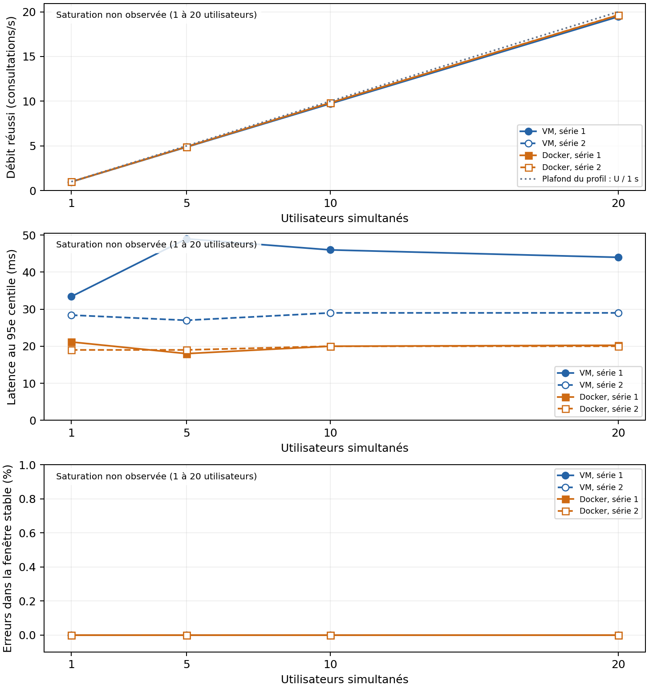

# Étape 18 — Analyser et comparer

## Objectif

Établir l'écart entre les trois machines virtuelles et les trois conteneurs, l'expliquer à partir des preuves disponibles et dire ce que la mesure ne montre pas. Les deux séries utilisent le même parcours candidat, les mêmes comptes fictifs et la même base de départ.

## Travail à faire

- Tracer le débit réussi, le p95 et le taux d'erreur selon le nombre d'utilisateurs, en conservant les deux répétitions visibles.
- Rechercher la saturation et rapprocher les courbes des métriques serveur.
- Remplir le tableau de synthèse et répondre aux quatre questions d'analyse.

**Lecture des courbes.** Aucun point de saturation serveur n'est observé de 1 à 20 utilisateurs : le débit augmente presque proportionnellement à la charge, le p95 ne croît pas durablement et les erreurs restent nulles. Les quatre courbes d'erreurs se superposent à zéro. La limite U/1 s du graphique est celle du profil avec réflexion, pas une capacité serveur mesurée. Chaque statistique porte sur 120 s stables, après 30 s de montée et 15 s de stabilisation. Les p95 des deux séries restent distincts ; ils ne sont pas moyennés.

<!-- page -->

## Le tableau de synthèse

| Grandeur | Trois machines virtuelles | Trois conteneurs |
| --- | --- | --- |
| Débit maximal soutenu | Au palier 20 : 19,458 / 19,500 consultations/s (séries 1 / 2) ; moyenne 19,479. Maximum observé, pas capacité maximale. | Au palier 20 : 19,633 / 19,650 consultations/s ; moyenne 19,642. Maximum observé, pas capacité maximale. |
| Charge au point de saturation | Saturation non observée entre 1 et 20 utilisateurs. Charge de saturation non déterminée. | Saturation non observée entre 1 et 20 utilisateurs. Charge de saturation non déterminée. |
| Latence au 95e centile, à charge égale | À 20 utilisateurs : 44,00 / 29,00 ms (séries 1 / 2). | À 20 utilisateurs : 20,25 / 20,00 ms (séries 1 / 2). |
| Goulot d'étranglement identifié | Aucun goulot serveur démontré. Le métier est le service le plus chargé en CPU mesuré. | Aucun goulot serveur démontré. Le métier est le service le plus chargé en CPU mesuré. |
| Temps de démarrage complet | 20,47 s, médiane des trois essais de l'étape 10. | 49,84 s, médiane des trois essais de l'étape 14. |
| Mémoire consommée au repos | 1 489,02 Mio : RSS hôte des trois processus VM, après 30 s de repos. | 581,96 Mio : RSS des conteneurs et du moteur avec ses auxiliaires rootless, après 30 s de repos. |

**Périmètre du tableau.** Les valeurs de charge viennent de l'étape 17. Démarrage et mémoire au repos sont repris des [mesures VM de l'étape 10](../../deploiement/docs/mesures-etape10.json) et des [mesures Docker de l'étape 14](../../docker/docs/mesures-etape14.json) ; ces essais antérieurs ne concernent pas la base dédiée de charge. Le démarrage va du lancement jusqu'à la première réponse HTTP 200 du catalogue attendu, avec cache hôte conservé. Il ne mesure ni une installation depuis zéro ni la seule durée de démarrage du processus serveur. La RSS n'est pas une consommation physique exclusive : les pages partagées peuvent être comptées plusieurs fois.

### Métriques serveur au dernier palier

| Service | CPU moyen VM, séries 1 / 2 | CPU moyen Docker, séries 1 / 2 |
| --- | --- | --- |
| Proxy | 3,39 / 2,43 % d'un cœur | 1,86 / 1,78 % d'un cœur |
| Métier | 27,92 / 26,26 % d'un cœur | 31,67 / 31,16 % d'un cœur |
| Données | 6,13 / 5,34 % d'un cœur | 7,08 / 7,02 % d'un cœur |

**Limite des compteurs.** Les VM utilisent le repli sur les processus encore vivants ; Docker utilise cgroup v2. Le CPU invité ne couvre pas le coût de l'hyperviseur sur l'hôte, et les compteurs Docker peuvent exclure les auxiliaires FUSE. Ces chiffres situent la charge interne, sans établir une supériorité énergétique ou un coût CPU total comparable. Les relevés complets comprennent aussi RSS, I/O et connexions PostgreSQL, avec au moins 22 observations stables par service et palier.

<!-- page -->

## Ce que l'analyse doit établir

### 1. De combien les deux déploiements diffèrent-ils ?

À vingt utilisateurs, le débit moyen des deux répétitions est de 19,479 consultations/s pour les VM et 19,642 pour Docker. L'écart absolu est de 0,163 consultation/s, soit +0,83 % pour Docker par rapport aux VM. C'est un faible écart de débit livré sous ce profil, pas un gain de capacité de 0,83 %.

Le p95 présente un écart plus marqué : 44,00 contre 20,25 ms dans la première série, puis 29,00 contre 20,00 ms dans la seconde. Docker réduit donc le p95 de 53,98 % et 31,03 % respectivement. Le p95 VM baisse lui-même de 34,09 % entre les deux passages, contre 1,23 % pour Docker. Deux répétitions ne permettent pas d'estimer une incertitude statistique robuste. Les valeurs individuelles sont conservées pour rendre cette variation visible.

| Utilisateurs | Débit moyen VM / Docker, req/s | p95 VM, séries 1 / 2, ms | p95 Docker, séries 1 / 2, ms |
| --- | --- | --- | --- |
| 1 | 0,975 / 0,983 | 33,40 / 28,40 | 21,15 / 19,00 |
| 5 | 4,871 / 4,904 | 49,00 / 27,00 | 18,00 / 19,00 |
| 10 | 9,738 / 9,833 | 46,00 / 29,00 | 20,00 / 20,00 |
| 20 | 19,479 / 19,642 | 44,00 / 29,00 | 20,25 / 20,00 |

Toutes les fenêtres stables ont un taux d'erreur de 0 %. Les 22 199 échantillons bruts, montée et connexion comprises, ne contiennent aucune erreur ; 16 902 consultations appartiennent aux fenêtres analysées. Les comptes sont distincts et les protections de connexion restent actives. Aucun HTTP 429 n'est observé.

### 2. Quelle propriété technique explique l'écart ?

Le débit est d'abord contraint par un profil fermé : chaque utilisateur attend une seconde avant sa prochaine consultation. En négligeant les autres coûts, U utilisateurs et un temps de réponse R produisent environ U/(1 + R) consultations/s, avec R en secondes. À vingt utilisateurs, le plafond du profil est donc vingt consultations/s. Un gain de quelques millisecondes de réponse influence peu ce débit ; il influence davantage les centiles de latence. Cette temporisation explique la proximité des débits, sans démontrer la cause de l'écart de p95.

Les environnements ont des propriétés différentes : les VM ont 1/2/2 vCPU et 1/2/2 Gio de RAM, tandis que Docker n'a pas de quotas explicites. Le trafic VM traverse la redirection NAT du proxy et le réseau interne ; Docker utilise les réseaux Compose et un moteur rootless avec stockage FUSE. Ces différences sont des pistes explicatives, pas des causes isolées par une expérience. Les deux métiers utilisent deux workers Gunicorn ; les sources, données et versions Django/DRF/Gunicorn sont communes, mais Python diffère (3.12.3 contre 3.12.15).

<!-- page -->

### 3. Quel composant cède en premier ?

Aucun composant n'a cédé dans la plage testée. Le palier à vingt utilisateurs reste sous le plafond du profil, avec des consultations réussies et sans hausse durable du p95. Il serait incorrect de nommer vingt utilisateurs comme charge de saturation, ou de transformer le débit maximal observé en capacité maximale du système.

Le métier est le composant interne le plus chargé en CPU mesuré, dans les deux déploiements : environ 26 à 28 % d'un cœur côté VM et 31 à 32 % côté Docker au dernier palier. La VM métier possède deux vCPU. Ces valeurs ne montrent pas une saturation CPU. La base conserve deux connexions dans les fenêtres relevées ; les observations périodiques des connexions actives peuvent manquer des requêtes brèves. Elles ne prouvent donc ni une absence de contention ni une saturation de PostgreSQL.

Les RSS du métier restent proches de 216 Mio côté VM et 227 Mio côté Docker à vingt utilisateurs. Cela ne mesure ni la RAM totale des invités ni la mémoire physique exclusive. Les I/O observées ne montrent pas un effondrement accompagné d'erreurs ou de débit stagnant ; leur méthode et leur cadence de cinq secondes empêchent néanmoins d'exclure toute attente disque. Le métier est un candidat à surveiller dans une extension de charge, pas un goulot établi. Pour identifier le premier composant limitant, il faudrait réétalonner, préparer plus de comptes et prolonger les paliers jusqu'à observer une rupture, avec instrumentation des attentes.

### 4. Que ne dit pas cette mesure ?

Les mesures portent sur un seul poste, une base fictive, un parcours de consultation des candidatures et vingt utilisateurs au maximum. Une préparation CSRF et une connexion sont exécutées une fois par candidat ; le plateau répète seulement la consultation. Le résultat ne décrit pas un flot continu de nouvelles connexions, des téléversements, la collecte d'offres ou un trafic métier varié. Il ne prédit ni la tenue en production, ni le fonctionnement sur plusieurs hôtes physiques, ni la résistance à une panne. Le nombre de lignes de la base n'est pas reconstitué dans ce rapport.

L'inversion de l'ordre fournit une seconde observation, pas une expérience contrôlée de chaque facteur. Le moteur Docker s'est arrêté après la première campagne VM ; la reprise a conservé cette campagne et introduit une interruption. De plus, la charge moyenne de l'hôte à cinq utilisateurs était de 16,89 % pour la première série VM, contre 5,27 % pour la seconde. Cette différence et la baisse du p95 rendent plausibles des effets d'état de l'hôte ou de cache. Les observations disponibles ne permettent pas de séparer ces effets de celui du déploiement. La panne du moteur est un incident de campagne ; les tests n'ont pas mesuré la reprise applicative après panne.

Les chiffres de démarrage et de repos décrivent des protocoles antérieurs : Docker consomme environ 60,92 % de RSS mesurée en moins, mais atteint le catalogue environ 2,43 fois plus tard dans ces essais. Les dépendances de santé Compose et les vérifications au démarrage du métier peuvent contribuer à ce délai ; leur coût n'a pas été isolé. Ces résultats ne justifient pas une conclusion générale selon laquelle les conteneurs démarrent toujours plus vite ou utilisent toujours moins de mémoire.

### Preuves et reproduction

Les [résultats bruts](../resultats/etape17/) et les relevés JSONL sont conservés. Les [calculs et empreintes](../resultats/etape18/analyse.json) et le [tableau des écarts](../resultats/etape18/comparaison.csv) permettent de contrôler les chiffres. Les courbes individuelles PNG/SVG sont dans `courbes/`. Depuis la racine d'Intern, lancer `python3 mesure/scripts/analyser18.py`, puis `python3 mesure/scripts/generer_rapport18.py`. La [procédure](../PROCEDURE.md) explique les contrôles ; aucun déploiement ni aucune charge n'est relancé par ces deux commandes. Le Markdown reste la source rédigée du rapport : le réviser si les campagnes changent. La conclusion soutenue est une latence plus faible pour Docker dans ces essais, un débit proche sous le profil choisi et une saturation non atteinte.
