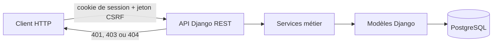

# Couche métier — API Intern

Cette partie contient l'API Python de l'application. Elle utilise Django REST
Framework, PostgreSQL et une authentification par session avec protection CSRF.
L'identité utilisée par les opérations métier vient exclusivement de la session
créée par le serveur.

## Organisation

- `app/config/` : configuration et routes principales ;
- `app/jobboard/api/` : contrôleurs HTTP et sérialisation ;
- `app/jobboard/services/` : règles métier et transactions ;
- `app/jobboard/models/` : modèle de données ;
- `app/jobboard/tests/` : tests automatisés ;
- `api.http` : scénario HTTP reproductible ;
- `requirements.txt` : dépendances exportées depuis `pyproject.toml` et `uv.lock`.



## Lancer l'API

Prérequis : Python **3.12.15**, épinglé dans `.python-version`, `uv` et PostgreSQL.

Depuis ce dossier :

```sh
cp .env.example .env
export UV_PYTHON_INSTALL_DIR="$(cd .. && pwd)/.execution/python-runtime"
export UV_PYTHON_DOWNLOADS_JSON_URL=https://raw.githubusercontent.com/astral-sh/uv/0.13.1/crates/uv-python-managed/download-metadata.json
uv sync --frozen
uv run --env-file .env app/manage.py migrate
uv run --env-file .env app/manage.py runserver 127.0.0.1:8000
```

La configuration est lue depuis les variables d'environnement. Le fichier
`.env` reste local et n'est pas versionné. Adapter les paramètres `POSTGRES_*`
à l'instance PostgreSQL utilisée.

## Contrat d'authentification et d'accès

1. Le client récupère le cookie et le jeton avec `GET /api/v1/auth/csrf/`.
2. Une inscription crée un compte inactif et répond `201 pending`.
3. Un superviseur active le compte depuis l'administration.
4. La connexion crée la session ; les requêtes d'écriture envoient aussi
   `X-CSRFToken`.
5. Les ressources privées sont toujours filtrées avec `request.user`. Un
   identifiant appartenant à un autre compte répond `404` sans révéler son
   existence.

Les réponses significatives sont `200` ou `201` en cas de succès, `401` sans
session, `403` si le rôle ou l'état du compte interdit l'action, et `404` si la
ressource n'existe pas dans le périmètre du compte connecté.

Le fichier [api.http](api.http) montre l'inscription, l'activation manuelle, la
connexion, la lecture de la session et un contrôle d'accès par propriétaire.

La limitation des connexions est active par défaut
(`AUTH_LOGIN_RATE_LIMIT_ENABLED=true`). Seuls les services dédiés aux tests de
performance la désactivent : voir [la configuration de mesure](../mesure/PERFORMANCE.md).

## Vérifier

Avec une base PostgreSQL de test isolée configurée dans `.env` :

```sh
uv run --env-file .env app/manage.py check
uv run --env-file .env app/manage.py makemigrations --check --dry-run
uv run --env-file .env app/manage.py test jobboard.tests.test_auth_api \
  jobboard.tests.test_recruiters jobboard.tests.test_workflow --noinput
uv run ruff check app/jobboard app/config --select E4,E7,E9,F,I
```

Les appels à des services distants sont simulés dans les tests. Ces commandes
valident le comportement local de l'API et de PostgreSQL.
